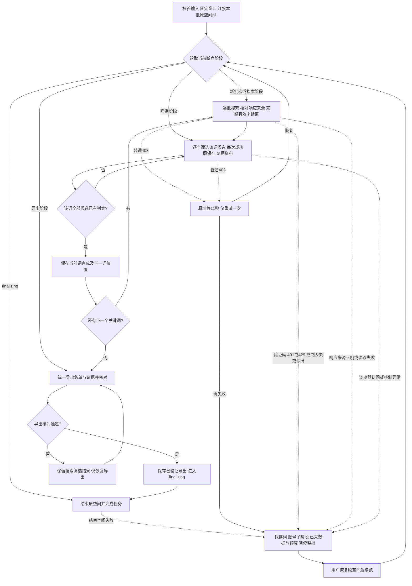

> **Preview副本说明（2026-10-22）**：本目录实际根为 `/Users/vb/Projects/creator-finder_preview`，不是下方历史记录中的原项目。新运行只使用本副本入口和新的 runs 目录；历史脚本/断点/绝对路径仅作归档，不恢复或重放。INS与邮箱模块已完成离线集成，入口及最新状态见 [Instagram协作说明](scripts/instagram-finder/README.md)。原项目和空间19未由本次开发操作。

# 达人查找项目

这个项目沉淀从关键词找候选、核验选人标准、补充地区信息，到导出名单和断点续跑的完整流程。目标是逐步做成可复用脚本，减少重复打开页面、手工判断和人工整理表格的时间，提高每次查找合格达人的效率。

**地区字段读取只是整套流程的一个部分。** 项目范围由整条找人链路决定，不能把项目缩成一个地区查询工具。

达人查找模块的设计、测试用例、实现计划及Review按用户2026-10-21指定，与代码放在 `scripts/tiktok-finder/docs/`；项目模块索引保留导航。

本文件是项目主记录和后续开发入口，集中维护已确认规则、现有实现、实际运行结果和待脚本化部分。后续改动先更新相关章节，避免规则散落在对话里。记录日期：2026-10-21，上海时间。最新AI扩展词第一轮已完成10词，累计候选1215位、导出22位（18确认、4疑似），本轮新增7位；可见按钮恢复已按用户新要求调整为每次至少等10秒、累计最多30次；实时进度见下方活动任务记录及运行目录的 `execution-state.json`。

## 项目目录

项目根目录：`/Users/vb/Projects/creator-finder/`。

```text
creator-finder/
  README.md                         完整找人流程与项目主记录
  scripts/
    tiktok-finder/                  多关键词查找模块（已实现，在线待验收）
      docs/                         设计、测试用例、实现计划与Review
    tiktok-search/                  可复用的关键词搜索、去重与搜索断点部件
    tiktok-browser/                 共用访问节奏及403等待11秒单次重试
    tiktok-video-region/            已实现的地区字段读取部件
      read-region.mjs               命令行入口
      region.mjs                    可复用模块
      region.test.mjs               测试
      README.md                     参数与结果说明
      验证与Review.md               该部件的验证记录
  runs/
    2026-10-21-tiktok/               本次真实任务、采集证据与阶段结果
      execution-state.json          进度、规则、断点和停止原因
      candidate-queue.json           候选队列和处理状态
      profile-账号.json             作者、公开简介、作品与判定证据
      all-qualified.json            全部达标账号
      qualification-pending.json    资格待核验
      rejected.json                 已排除账号
      us-subset.json                旧地区口径下的美国地点线索子集
      country-pending.json          地区待核验子集
      regions/                      后续地区字段观察结果，按需生成
      session-steps/                本次 Ego 浏览器操作脚本
      kolkoc-source/                第一份交接包的原始逻辑与测试
      linkedin-source/              第二份交接包源码，当前未执行
      build-results.mjs             本次表格生成脚本
      outputs/                      表格和核验预览
```

旧的 `/Users/vb/Tools/tiktok-video-region/` 和本次对话的 `finder-ego/` 路径保留兼容链接，实际文件集中到此项目。历史表格链接和已有调用仍可访问，后续新增工作优先使用项目内路径。

## 已确认的整体目标与范围

- 当前先完成 TikTok 找人，再考虑复用到其他平台。LinkedIn 包只作为参考，不能把它的规则、目标或状态混入本次 TikTok 任务。
- 浏览器操作使用 Ego Lite，复用同一任务空间和正常页面产生的公开响应。
- 寻找符合当次业务标准的达人，并输出可解释、可追溯的名单。
- 参数、状态、采集证据、判断结果、表格导出应逐步串成一个可启动、可暂停、可继续的脚本入口。
- 所有名单必须包含“收录依据”，逐人解释实际满足了哪些条件、证据在哪里。不能只写“符合标准”。

[统一找人入口](scripts/tiktok-finder/README.md)已实现配置、多关键词顺序执行、账号断点、完整窗口统计及统一导出。初始交付90/90项离线验证和两轮实现Review已完成；2026-10-21追加搜索简介邮箱预筛后，模块50/50、依赖57/57通过。真实新批次在线端到端尚未验收。历史任务片段保留固定参数作证据，不作为新的通用入口。下文实际查找过程保留历史阶段描述，最新脚本状态以该模块说明及验证记录为准。


## 2026-10-22 已确认的下一步流程调整

用户最新将N设为20：每个关键词前20位去重作者强制核验主页；搜索仍翻到底，第21位起沿用原signature邮箱预筛。前20按本词搜索响应首次出现顺序，跨词重复复用本批完整核验。主页保存Bio、邮箱及独立挂链字段；挂链不代替Bio邮箱，也不自动访问站外。参数已支持，历史批次冻结配置不改。

三份文档与需求Review已放在[前N位强制主页核验设计](scripts/tiktok-finder/docs/2026-10-22-前N位强制主页核验-设计.md)同目录。Brainstorming需求评审与用户流程图确认已完成，代码已实现并通过155项测试及bounded实现Review。新配置forceProfileFirstN=20；原22位名单继续人工核验，未启动新搜索。交付见模块同目录开发验证与实现Review。

## Instagram 搜索模块

用户已要求新开独立对话，将同一关键词→视频作者→核验→汇总流程适配到Instagram。专用目录为[scripts/instagram-finder](scripts/instagram-finder/README.md)，[启动交接](scripts/instagram-finder/docs/启动交接.md)记录复用规则、平台差异和未确定输入；本preview副本已实现INS搜索/主页/地区/均播部件及邮箱协作通用入口；最新使用说明见该模块README。复制来的原批次仅历史快照，不从本副本恢复。正式文档与代码同模块存放。

## 主页邮箱递归查找模块

[独立脚本与用法](scripts/profile-email-finder/README.md)已实现三平台资料与挂链、纯规则邮箱提取、A→B→C逐链接递归、去重/断点和来源输出；普通网页仅联系线索/@/mailto，不整站爬取，不改变既有找人资格。按最新规则先检查简介：有明确邮箱就结束该主页挖链，没有才继续挂链。流程图及明确规则已收敛，当前页与目标规范化URL一致时直接复用，不重新打开；最新100项模块及项目脚本全量389项通过。三平台分别实测；按用户最新要求Linktree直接跳过，普通外站访问失败记录skipped后继续，不重试或阻塞其他分支。Brainstorming需求/实现Review已完成，独立Reviewer未做，无Git未提交。详见[开发验证与实现Review](scripts/profile-email-finder/docs/2026-10-22-主页邮箱递归查找-开发验证与实现Review.md)。

## 当前活动任务（2026-10-21 更新）

最新[AI扩展词第一轮](runs/2026-10-21-ai-keywords-round-1-us-100/)已完成10/10词、全词有效末页及筛选。累计库1215位，本轮新增候选281位；累计名单22位（18确认、4疑似），新增7位，未达到100目标。状态completed/completed，原空间18已正常finish，无活动进程。结果表含逐人收录依据、公开邮箱及地区/播放证据；原统计窗口保持，旧资料沿用采集快照。

131项脚本测试、名单独立核算、XLSX文本ID/公式缓存核对通过。6个目标共43次实际“重新加载”点击均至少间隔10秒，全部恢复；恢复并不等于资格通过。正文读取异常的同空间补跑已记录为本批恢复入口，尚未合入通用入口；不宣称该类异常已全自动恢复。逐词数据见[本轮搜索统计](runs/2026-10-21-ai-keywords-round-1-us-100/outputs/本轮搜索统计.md)，质量核对和限制见[阶段记录](runs/2026-10-21-ai-keywords-round-1-us-100/阶段记录.md)。用户选择先停止，人工核验现有22位；下一组10个细分扩展词暂缓，需后续明确授权才搜索。

以下为此前15词复查记录。

最新一轮[15词重新搜索核对](runs/2026-10-21-all-15-keywords-recheck/)已完成，空间15已正常结束。全部15词均取得有效末页，本轮778位命中作者均有逐词处理记录；新增候选252位，累计库934位。前10词复查新增候选91位/收录1位，后5词首搜新增候选161位/收录0位。累计名单15位（12确认、3疑似），新增chanceforchrist；统计窗口和选人条件保持原样。

旧名单mulletmitchy未再次命中，已在本批表格收录依据注明，保留原核验记录；旧账号均播未全部刷新。两次搜索结果集合不同，不能把“相同数据应0新增”的假设当作现场事实。完整对照见[重新搜索对照核对](runs/2026-10-21-all-15-keywords-recheck/outputs/重新搜索对照核对.md)，真实恢复及验证见[本批阶段记录](runs/2026-10-21-all-15-keywords-recheck/阶段记录.md)。131项测试与名单独立核对通过，代码Review已完成，独立Reviewer未做。

这组10个AI扩展词已授权并完成，最新结果见上方第一轮记录。以下为更早已完成记录。


最新一轮为[累计10词或100位补充查找](runs/2026-10-21-christian-comedy-10-keywords-or-100/)，已达到累计10词上限正常停止。包含前批两词，共处理682/682位唯一候选，11位confirmed、3位suspected，累计14位（新增4位），没有达到100位。当前completed/completed、completionReason=keyword_limit_reached、无运行进程，原Ego空间13已正常结束。

后5词为pending：relatable christian skits、christian meme comedy、bible story comedy、church funny moments、christian funny skits。全部用户15词完成后再由助手生成去重新建议，先问用户再搜索；当前尚未触发新词生成。本轮仍按原统计窗口、US视频地区、公开Bio邮箱、均播严格大于50000及收录依据核验。新配置maxKeywords=10、stopAtTarget=true；历史批次默认全词策略不变，原批不覆盖。

本批入口run-in-ego.mjs继续调用统一模块，全部点击/翻页/403由脚本串行执行；导出委托配套Node运行同一exportResults，已自动成功导出并验证。最终14位的邮箱/地区/独立均播核算和XLSX文本ID/公式缓存核对通过，三张预览已查看。真实运行及剩余任务见[本批阶段记录](runs/2026-10-21-christian-comedy-10-keywords-or-100/阶段记录.md)。

以下为前一批已完成记录。


当前任务关键词按顺序为 `bible comedy`、`christian skits`，目标20人，美国，近10天有效公开视频均播严格大于50,000；继续要求当前主页Bio公开邮箱，内容需支持基督教主题短剧/喜剧。固定统计窗口为上海时间2026-10-11 00:00至2026-10-21 00:00（结束不含）。运行参数与证据在[本批目录](runs/2026-10-21-bible-comedy-christian-skits-us-20/)，配置在[task-configs](runs/task-configs/2026-10-21-bible-comedy-christian-skits-us-20.json)，断点记录使用Ego空间8与p1。

两个关键词均已完成搜索与筛选，去重后200位候选全部处理；最终9位confirmed、1位suspected，总计10位，少于目标20位，实际不足10位。最终断点为`completed/completed`，无运行进程；原Ego空间8由脚本调用`finish({keep:[]})`正常结束。

此前`r3alism_0fficial`由脚本点击可见按钮1次恢复、`mattfrostofficial`点击4次恢复；`christiandude4`点击10次仍403后暂停。本次用户将可见按钮规则提升为累计30次、逐次先等至少10秒，保留已用次数（10次断点最多再补20次）。接管原页时视频已经正常，脚本直接读取`locationCreated=SZ`并排除，随后处理剩余7位；本轮没有新增按钮点击，不能把离线30次测试称为真实在线30次验证。

已导出[10位最终名单](runs/2026-10-21-bible-comedy-christian-skits-us-20/outputs/TikTok-达人查找结果.xlsx)，包含逐人收录依据、公开邮箱、窗口均播、主页与视频地区证据。已重算均播并核对缓存、检查完整长ID按文本保存、查看三张表的预览。Ego内置运行时加载制图库时遭macOS签名拒绝，采集不受影响；已用Codex配套Node运行现有`--export`入口完成导出，再由本批`finalize-verified-export.mjs`调用现有workflow验收输出并结束原空间。该批已收口；通用Ego运行时的制图库兼容问题没有在本轮改动中重构。

实现与在线证据见[tiktok-finder开发验证与Review](scripts/tiktok-finder/docs/2026-10-21-开发验证与实现Review.md)。

2026-10-21新增邮箱预筛规则后，后续从当前断点恢复时，未检查候选使用新规则；已完成的作者记录和搜索证据不重算、不覆盖。

上一批 `christian skits` 单关键词5人任务已完成，共151位候选、36个主页已检查；结果与收录依据见[阶段记录](runs/2026-10-21-christian-skits-us-5/阶段记录.md)及[结果表](runs/2026-10-21-christian-skits-us-5/outputs/TikTok-ChristianSkits-美国5人-20261021.xlsx)。

首批 31/50 的结果保留作历史，不将其冒充本批 5 人结果。

## 首批任务参数范例

每次任务启动时固定一份参数，恢复时沿用该份参数，避免中途移动统计窗口或静默改变门槛。

| 参数 | 本次已确认值 | 后续脚本要求 |
|---|---|---|
| 平台 | TikTok | 独立于其他平台配置 |
| 关键词及顺序 | `skit`、`comedy`、`humor`、`bible`、`christian` | 保持输入顺序 |
| 内容方向 | 命中任意一个方向即可 | OR 关系，不要求五项同时满足 |
| 总目标 | 50 位唯一合格达人 | 首批历史规则是达到后停止；后续多关键词新要求以全词处理完成为结束条件 |
| 邮箱 | 当前已核验主页 Bio 的公开文字邮箱 | 搜索摘要和猜测不替代主页核验 |
| 均播门槛 | 严格大于 50,000 | `> 50000`，不是 `>= 50000` |
| 统计区间 | 上海时间 2026-09-21 00:00 至 2026-10-21 00:00，结束时刻不计入 | 30 个完整自然日，保存明确起止和时区 |
| 粉丝门槛 | 未设置 | 不能套用其他 Skill 的默认粉丝/点赞门槛 |
| 最少作品数 | 未额外设置 | 本次一条有效作品也可能达标，不能新增隐藏门槛 |
| 地区 | 先完成非地区资格筛选，再补充地区或形成子集 | 地区依据与内容/邮箱/均播资格分开 |
| 时限 | 本次没有设置新的截止时间 | 不继承原包中的历史截止时间 |

未来任务可以修改这些参数，50 位和 5 万均播不是所有任务的永久默认值。历史任务恢复时必须保留原参数，并明确说明是否存在新的用户变更。

## 完整找人流程

下图记录已确认并实施的多关键词流程；[统一入口用法](scripts/tiktok-finder/README.md)及[开发验证与实现Review](scripts/tiktok-finder/docs/2026-10-21-开发验证与实现Review.md)记录当前状态。对应[模块设计](scripts/tiktok-finder/docs/2026-10-21-多关键词顺序查找-设计.md)、[测试用例](scripts/tiktok-finder/docs/2026-10-21-多关键词顺序查找-测试用例.md)、[实现计划](scripts/tiktok-finder/docs/2026-10-21-多关键词顺序查找-实现计划.md)的需求评审已完成，流程图已于2026-10-21获用户确认，已完成Red、Green、回归及两轮实现Review，真实在线新批次待验收。

本次[脚本操作流程Review](scripts/tiktok-finder/docs/2026-10-21-脚本操作流程Review.md)发现混合HTTP状态误重试、部分响应失败仍标耗尽、旧词响应串入新词，以及账号内断点/作品分页重试缺口；已回写设计与38项开发验收契约，后续已修复旧搜索器三项问题，并在新模块实现账号断点和分页重试；历史采集片段不改。新增模块测试与原组件回归均通过，离线验证不能替代真实网站验收。用户已确认超目标全部导出、只放宽内容方向，数据条件仍须核实。



### 1. 获取候选

优先从 TikTok 视频搜索结果批量取得作者和来源作品。Google、Bing 搜索可作补充入口，必须保存实际查询、结果来源、分页或游标及完成状态。

关键词只是发现入口。搜索到账号不等于资格通过，搜索摘要中的邮箱不等于当前主页邮箱。对要求公开Bio邮箱的任务，当前脚本先以搜索响应`author.signature`做省时预筛：签名为空，或没有邮箱且结尾没有明显省略标记时，按必备邮箱条件排除并跳过主页；有邮箱提示或明显省略结尾时才开主页核验当前Bio。已有同批主页核验缓存优先复用。该规则可能漏掉无标记静默截断的简介，因此排除依据明确标注“主页未核验”；它是邮箱条件的候选预筛，不代表主页邮箱事实。可见尾部省略标记仅包括`...`、`…`、`⋯`、`﹒﹒﹒`等。

同一个账号在多个关键词、多个搜索引擎出现时，合并来源并减少重复访问。核验前可用用户名去重，核验后用稳定作者 ID 去重，保留当前用户名与来源之间的对应关系。

必须区分“结果已翻完”和“页面没加载出来/受到限制”。最新多关键词要求为全部输入词完成搜索及筛选后才结束；中途达到目标人数也继续后词。首批历史“达到目标提前停止”不再作为新多词入口的停止规则。未检索的词不能称已完成。

#### 多关键词顺序执行（2026-10-21已实现，在线待验收）

- 新入口接收有序 `keywords` 数组，例如 `["christian skits", "bible comedy", "church humor"]`；短语作为一个词，去首尾空格并稳定去重，不按空格拆分。
- 当前词正常分批搜索直到有效响应明确结束，再完成该词所有候选的筛选和结果保存，才进入下一个词；按输入顺序循环到最后。
- 全词共用固定筛选条件、统计窗口和作者去重库；重复作者合并所有来源词及新增证据，复用已采资料，不重复打开主页或重算已完成动作。
- 每个词分别保存searching/filtering/completed及搜索断点。内容疑似且主要条件满足仍可交付并标疑点；普通字段缺失留明确缺口。浏览器访问/控制异常暂停整批，不假装当前词完成或跳去下词。
- targetCount用于进度与最终不足说明，不提前终止、不裁掉超目标结果。普通403同址等待11秒重试一次；任一查找阶段若错误页明确显示HTTP ERROR 403或ERR_BLOCKED_BY_CLIENT且带可见“重新加载”按钮，则每次先等至少10秒再点一次并检查，最多30次，逐次保存已用次数，失败从当前词当前阶段暂停。搜索翻页至少10.5秒；主页作品翻页至少3秒；其他浏览器动作保持至少10.5秒，均串行执行。
- 当前 `scripts/tiktok-search/search.mjs` 仍是单词搜索部件，不是上述完整调度器；新行为已在统一入口实施，旧CLI保留兼容用途。历史已交付5人任务不因此重开或重算。

### 2. 预筛并核验公开邮箱

必需邮箱任务先看搜索响应中的作者`signature`。空简介，或没有邮箱且无明显尾部省略标记时，按当前规则直接排除并不访问主页；记录搜索签名状态以及主页未核验说明。显式截断标记可能掩盖后续邮箱，因此仍要打开主页；有邮箱样式文本也必须开主页验证它是否仍存在于当前公开Bio。

进入主页后，确认页面作者 ID、用户名与候选一致，主页公开且返回有效；身份不符、错误页面、资料未加载完成时不能作出主页邮箱结论。邮箱只取当前Bio的明确公开文本，保存原文、主页链接和采集时间。不猜邮箱、不拼接邮箱，也不自动进入站外链接寻找邮箱。搜索预筛命中不是“已核验主页邮箱”。

结尾`...`、`…`、`⋯`、`﹒﹒﹒`属于“疑似截断”启发式；它不能识别没有标记的静默截断。已有批次抽查70个签名与主页Bio完全一致，但33个非空签名未作对照，不能据此保证所有简介完整。此风险写入提前排除记录，供人工复核时识别。

有待采作品的候选在主页邮箱检查后，再做成本较高的作品分页与均播计算。邮箱未通过时不继续采作品或地区，减少额外访问。

这里的“身份核验”是防止抓错账号：对照候选用户名、当前主页链接及已知稳定作者ID，确认实际加载的是目标作者。它不验证自然人的真实身份或账号所有权。“邮箱核验”只确认邮箱文字确实出现在当前有效主页的公开Bio，保留原文、链接和时间；不代表已经验证邮箱可以收信或归属本人。

### 3. 获取内容方向证据

根据公开 Bio、作品合集名称或公开作品文案判断，保存具体原文和链接。当前已使用的证据包括 `skit`、`skits`、`comedy`、`comedian`、`funny`、`prank` 等明确方向线索；需要人工判断时明确标记人工复核。

原包自动规则使用Bio/合集明确自述，或两条相关文案的严格启发式。本批最终按用户明确的“只要涉及基督教主题的短剧或喜剧即可”判断，人工核验可采用已确认身份且主题与形式均明确的公开文案，不把自动规则的两条门槛另设为用户要求。较早作品必须注明日期，不能据此宣称账号近期持续发布该主题。宗教讽刺同样允许，收录依据应如实写出公开文案，不推断个人信仰。不能只因为搜索命中某关键词就判定符合内容方向，也不能依靠对账号的印象。若只检查了文案，应如实写文案证据，不声称已经观看并确认视频画面。

内容方向与播放统计窗口是不同条件：本次允许窗口外仍公开的作品或置顶作品提供方向证据，播放均值只使用统计窗口内作品。`bible`、`christian` 表示公开内容主题，不证明个人宗教信仰。

### 4. 核验配置时间窗口覆盖与算术均播

读取正常主页产生的作品列表响应，保存作品 ID、作者 ID、发布时间、精确数字播放量、文案、置顶/私密标记和作品链接。优先一次取得后续多处可复用的字段，避免为同一指标反复开页。

确认主页按“最新”排序，逐页获取，直至看到窗口开始前的非置顶作品，或列表明确结束。置顶旧作品不能被当成时间顺序边界。检查作者一致、非置顶时间顺序、重复作品和响应完整性。

窗口内有效作品去重后计算：

```text
均播 = 窗口内有效公开作品的播放量总和 / 作品数量
达标 = 覆盖完整 且 数字有效 且 均播 > 任务门槛
```

本次沿用当前采集器对公开作品的统计口径。不能只挑高播放作品、只算首页几条，或把置顶旧作品放入窗口。使用精确数字，不能把页面显示的 K/M 缩写当成精确原始值。真实 0 保留为 0；缺失值保持未知，不能补成 0。

覆盖不完整、作者或日期不一致、播放数缺失时进入待核验，不强行计算合格均播。

分页已经存在于本批 `session-steps/collect-profiles.ego.mjs`：正常向下滚动触发下一批作品，等待加载后读取，达到窗口边界或页面明确结束即停止。搜索翻页间隔至少10.5秒；主页作品翻页间隔至少3秒；主页打开、排序及地区详情等其他动作至少10.5秒。按批串行、等待加载、复用已采字段与结果，不持续快速滚动或无必要地重复开页。

### 5. 地区字段读取部件

此部件只补充地区证据，不替代前面的邮箱、内容方向和均播筛选。

已实现 [地区脚本](scripts/tiktok-video-region/read-region.mjs) 和[使用说明](scripts/tiktok-video-region/README.md)。默认选择已核验主页快照中按发布时间排序的最新一条公开视频，支持最近三条。不是直接取首页第一个卡片，也不是把所有置顶作品排除；真正最新的置顶作品仍可入选。

先检查正常主页作品列表是否已返回同名 `locationCreated`。有可用值时复用该响应，省去详情访问；没有时才正常进入视频详情，读取：

```text
__DEFAULT_SCOPE__["webapp.video-detail"].itemInfo.itemStruct.locationCreated
```

每条保存字段原值、规范化地区代码、作者/作品 ID、视频链接、发布时间、采集时间与字段路径。视频身份必须与目标一致，不能读取浏览器上下文的 `webapp.app-context.region` 充当作者地区。

| 情况 | 记录口径 |
|---|---|
| 最新一条有效且 `US` | 美国（最新视频地区字段） |
| 要求三条且三条均为 `US` | 美国（近期三条视频地区字段一致） |
| 三条不足或字段缺失 | 证据不足，地区待核验 |
| 多条代码冲突 | 地区字段冲突，待核验 |
| 主页 Bio 写 `NYC` 或 `Alabama` | 简介中的美国地点线索，不能冒充已核验现居地 |

`locationCreated` 是观察到的网页内部字段。[抓取工具文档](https://apify.com/clockworks/tiktok-scraper/output-schema)将其解释为视频创建国家代码；当前没有在本项目中核实 TikTok 对这个内部字段的官方定义，不能把它直接等同于本人现居地、国籍或受众国家。此前 @tussalty 的一条视频确实读到 `US`，但多条一致性核验受到 403 中断；[该次选定字段记录](runs/2026-10-21-tiktok/region-reference-observation.json)保留此限制。

当前地区部件已接入本次采集器的新达标账号处理位置。它会生成 `regions/<账号>.json` 并保存到账号的 `videoRegion`；当前历史 31 位尚未批量补取，旧表的地区列也没有按此字段重新计算。

### 6. 资格判定与结果分组

- 合格：当前主页邮箱、任一内容方向和完整窗口均播均满足本次条件。
- 疑似符合、收录待人工复核（最新用户规则）：内容方向有歧义但主要条件符合时，也进入交付候选名单，在“收录依据”中写清支持证据、疑点和未确认项，由人工检查最终结果；不再仅因内容语义不确定而将其排除在交付名单之外。
- 待核验：任何必要条件存在缺失、覆盖不完整或证据不足。保存具体缺口，恢复时只补缺口。
- 排除：已确认不符合某项必要条件，保存实际原因。

上述新增规则针对用户本轮指出的内容歧义；不把未知播放量、错误作者或未取得的地区字段写成已满足。“大部分”尚未定义数字比例，本轮不擅自设定3/4或评分阈值，也不修改当次任务设定的均播门槛。交付统计需区分“已验证符合”和“疑似符合、待人工复核”，历史已完成批次及其表格保持原判定快照。该规则已接入新的统一入口和导出；旧采集器及历史名单保留原快照。

地区判断单独保留来源和不确定性。未知地区不等于非美国；是否只输出某个国家，应由当次任务参数明确决定，不能静默改变全局收录规则。

### 7. 输出表格与收录依据

结果表必须包含“收录依据”，逐人写明：

1. 内容方向来自哪段公开原文，命中哪个方向。
2. 邮箱来自当前主页的什么原文。
3. 统计窗口、有效作品数、算术均播及其与门槛的比较，覆盖是否完整。
4. 地区依据单独说明，原值、来源及待核验状态不能混同于资格达标。
5. 判断用到助手/大模型补审或人工复核时如实注明。疑似符合而先行收录时，明确写出疑点与待人工复核事项，不能写成所有条件均已确认。

不要只写模板式“符合标准”。例如：“作品公开文案含 #comedy、#skit；主页公开列出邮箱；固定窗口内 1 条有效作品，均播 1,800,000，严格大于 50,000；所在地仅有 Bio 中 NYC 线索，现居地未核验。”

本次表格包含“合格达人”“主页证据”“视频证据”三页。稳定 ID 按文本保存，避免长数字精度损失；主页与逐作品来源能追溯到汇总。导出前核对人数、去重、计数、均播、时间窗口、表格公式和排版。

### 8. 暂停、恢复与访问保护

同一任务使用原 Ego 空间，不通过新空间、新身份、换 Cookie 或更换访问路线规避阻断。普通403按下文新规则同址等待11秒后重试一次；任一查找阶段的明确浏览器错误页若带可见“重新加载”按钮，每次先等至少10秒再点一次并检查，最多30次。遇到验证码、401/429时保存断点并暂停；普通可关闭登录提示先检查实际页面，不直接宣称必须登录。

用户处理并确认继续后，先查看原页面与控制权，确认正常再从原断点继续，不重跑已完成队列。任务参数、已核验邮箱、作品证据、待补缺口、搜索游标和停止原因都需要持久化。

本次 TikTok 导航沿用至少 10.5 秒间隔，且与地区脚本共用访问时间记录。缩短总流程优先靠减少重复访问、提高候选命中和早筛效率，不能把绕过验证码或忽略访问保护当成提速方式。

## 首批任务阶段进度（历史保留）

以下为 2026-10-21 已保存的阶段状态，后续以 [execution-state.json](runs/2026-10-21-tiktok/execution-state.json) 为准：

| 项目 | 已保存状态 |
|---|---|
| 唯一候选 | 179 |
| 已检查主页 | 100 |
| 主页公开邮箱已核验 | 80 |
| 播放指标通过 | 41 |
| 最终合格 | 31 / 50 |
| 资格待核验 | 30 |
| 已排除 | 39 |
| 旧地区子集 | 2 位有美国简介地点线索，29 位地区待核验；不是已确认 2 位现居美国 |
| 已搜索关键词 | 当前仍在 `skit` 阶段；其他四个尚未开始 |
| 原浏览器空间 | 328，已交还用户 |
| 运行状态 | 已停止，无采集进程在运行；等待 403 恢复 |

阶段成果：[当前表格](runs/2026-10-21-tiktok/outputs/TikTok达人筛选-20261021.xlsx)，31 位均已补齐“收录依据”。当前共有 1,017 条逐作品证据，包含窗口边界外作品，并标记是否计入均播。

## 现有实现和后续脚本化方向

| 环节 | 当前状态 | 下一步需形成的能力 |
|---|---|---|
| 任务参数与总目标 | 已记录，本次参数固定 | 参数化入口与参数校验，恢复时核对配置 |
| 候选发现 | 可复用参数化搜索入口已落地，候选/来源/游标持久化 | 与主页核验和总目标调度连接 |
| 作者与邮箱核验 | 已运行并留证 | 可复用采集模块与结果缓存，区分未知/明确没有 |
| 作品覆盖与均播 | 复用原包纯逻辑并已完成本次核验 | 统一 Ego 采集适配、日期/覆盖异常处理 |
| 内容方向 | 规则判断加少量明确人工复核 | 统一原文依据生成，疑难情况保留人工环节 |
| 地区字段 | 独立模块已接入，当前批次3位在线读取成功 | 继续记录字段缺失、冲突及真实可用性 |
| 结果与“收录依据” | 已有本次表格生成器 | 将各环节证据统一映射到结果表 |
| 断点与总入口 | 本次有状态文件和操作脚本 | 一处启动、继续、查看状态、导出阶段结果 |

后续优先把已验证步骤连接成参数化、可续跑的单入口，再优化搜索命中率和昂贵步骤的触发时机。不同任务的数据分别放入 `runs/<任务标识>/`，不能把上一批名单、统计窗口、Cookie 或截止时间混入新批次。

提速效果以“每位合格达人耗时、页面打开次数、人工介入次数、重复访问次数”衡量，同时保留资格准确性、证据完整率、地区字段可用率和错误恢复情况。本次尚未建立这些耗时基线，不能预先宣称已提升多少倍。

未来开发前再细化当次实现范围和验收；此处记录方向，不代表整套脚本已经完成或可无人值守运行。

## 本次实际查找过程与固定流程脚本化

这一节区分已经执行的步骤、实际人工介入，以及尚待实现的统一入口。以下基于 `christian skits` 本批保存的搜索响应、主页记录和停止报告。

### 本次实际执行顺序

1. 复用原 Ego 空间328，检查原页面恢复正常后，在 TikTok 的“视频”搜索中打开 `christian skits`。本批没有使用Google或Bing。
2. 正常搜索加载首批结果，再滚动3次；4批响应各有12条，共48条视频搜索结果。读取其中作者ID、账号、简介提示、文案、来源作品和搜索游标，去重后形成30位候选。
3. 优先处理搜索结果中带有邮箱提示的候选。提示只用于排序，必须打开本人当前主页，核验作者ID、公开状态和Bio邮箱。实际顺序为 r3alism_0fficial、danielddwilliams、vanceelliottcomedy、realjobrito。
4. 对有公开邮箱的主页，读取页面正常加载和滚动产生的作品列表响应。一次保留日期、播放量、文案、置顶/图文标记等，供多个判断复用。
5. 确认按最新排序，获取到10天窗口的完整边界后，排除窗口外、私密和图文作品，按作品ID去重，计算算术均播。本批30、7、6、3条有效视频分别对应185,866.67、60,045.14、33,635.33、234,771.67均播；vance因均播不足而排除。
6. 用公开Bio、合集、作品文案和已核验作者ID对应的TikTok原生搜索作品文案判断内容。r3alism和Daniel的部分标签被旧规则漏识别，实际由主助手复核已保存文案，记录为人工复核，未将其伪装成规则自动通过。
7. 非地区条件通过后，检查最新公开视频地区。正常主页作品列表若没有可用 `locationCreated`，才进入该视频详情。realjobrito的详情导航返回HTTP403，发生在成功读取地区字段之前；随后保存证据、状态和26位未处理队列，交还原空间。

上述是原403暂停时的历史快照。恢复后3位均已读取到最新视频的 `locationCreated=US`；当前进度以活动任务状态为准。该字段不证明本人现居地。

### 当前已具备和仍需串联的能力

| 能力 | 当前情况 | 统一入口应做什么 |
|---|---|---|
| 搜索与候选去重 | 参数化搜索部件已实现，支持继续翻页与保存 | 当前词逐批搜至有效结束，再完成筛选并切词；不是候选够了就停 |
| 当前主页与邮箱 | 分段采集器已执行 | 固定身份校验，按公开邮箱判断，未知与明确没有分开 |
| 视频分页与均播 | 已有纯判定函数和采集片段 | 从任务配置读取窗口，完整覆盖后才判定 |
| 内容方向 | 规则加实际助手补审 | 按最新规则，内容疑似且主要条件符合也交付，标明证据与疑点供人工最终复核 |
| 地区字段 | 独立模块已接入 | 当前目标页面已正常加载时直接读取，避免重复导航；缺字段才进入详情 |
| 状态与恢复 | 已保存任务及账号证据 | 按账号保存每项检查状态和下一步，不只记录“检查过” |
| 表格及收录依据 | 首批已有生成器 | 由结构化判断和来源自动生成逐人依据，连接新任务参数 |
| 操作入口 | 尚未统一 | 提供启动、继续、查看进度、导出阶段结果四个固定入口 |

当前的脚本仍包含批次路径、日期、人数与空间ID，需要由主助手串联；不能直接称为已经完成的通用找人程序。

### 推荐固定下来的运行方式

每批输入有序关键词数组、目标人数、地区、窗口天数、均播门槛和是否要求主页公开邮箱，生成并固定任务配置。逐词搜索完、筛选完再进入下词，全部词完成才结束；沿用一个Ego空间，持续复用正常页面响应。

按低成本到高成本执行：先去重并用搜索简介预筛必需邮箱，再对有邮箱提示或疑似截断的简介核验当前主页邮箱；读取作品列表时同时收集内容、时间、播放和可用地区字段。能够确定不符合条件的账号及时结束检查。需要完整时间窗口的均播，采全前不能只看首页均值就排除。均播不达标时省去额外的地区详情访问。

内容规则应拆开“Christian主题证据”和“短剧/喜剧形式证据”，考虑 `#christiantiktok`、`#christianhumor`、`#christianskit` 等组合标签，以及搜索结果中已确认作者身份的公开作品。规则明确的情况自动判；按用户最新要求，内容有歧义但主要条件符合时先以“疑似符合、待人工复核”交付，保存实际证据和疑点，人工拿最终结果核验。不得把这种候选收录标成全部条件已确认。

每个账号保存邮箱、内容、播放、地区四项检查结果、来源和未完成动作；搜索简介预筛排除时注明主页未核验。像本批3位只缺地区的账号，恢复后只补地区，不重新采集10天视频。已验证合格人数只统计全部必要条件通过且作者ID唯一的账号；按新规则进入交付名单的疑似候选另列数量和未确认项，避免混淆。

普通403同址等待11秒后仅重试一次；再次失败、验证码或控制权交还时保存并暂停，用户处理后继续原阶段。任一查找阶段的明确错误页若有可见“重新加载”按钮，则按单独预算最多点击10次；已点击次数随检查点保存。固定流程可以减少重复操作并保证进度可恢复，不能承诺网站永不限制访问或完全无需人工介入。

此处记录开发前的分段操作；后续统一入口已完成离线实施，真实在线验收尚未进行；不包含自行突破网站限制、切换身份或增加并发的方案。

### 本次只读核对中的小修正

核对操作片段时发现，本批采集器的分组写出循环使用了与外层结果列表同名的变量，会使后续运行在保存分组时出现暂时性死区错误。新增离线校验直接执行实际分组写出片段（用内存写入代替磁盘），先复现错误，再更换循环变量名。复验确认写出0位合格、3位待核验/地区待核验和1位排除，脚本语法检查通过。未重新访问浏览器或改变当前名单。

代码Review：该单点修正已做bounded只读复核，未发现未处理阻塞项；独立Reviewer/PR Review未做。校验入口为本批 `session-steps/verify-partitions.mjs`，该校验针对本批当前快照，不是未来通用运行器的测试。

## 来源、验证和后续入口

原始来源包保持原位：

- `/Users/vb/lobsterai/project/kolkoc_finder-Codex交接包-20261020.zip`
- `/Users/vb/lobsterai/project/linkedin-finder-v1.1.5-源码及原位置无时限续跑.zip`

提取后的原始源码已随本次运行归档。原包浏览器适配层依赖龙虾，不能把原包入口的离线测试通过当成 Ego 端到端验收；当前只复用其纯判定逻辑，并通过本次 Ego 操作脚本执行采集。

地区部件测试、原筛选回归、真实快照离线选取和迁移检查记录保留在本次 `runs` 中。在线验证状态必须与离线测试分开报告，不能把一条字段可读直接宣传成地区准确率或批量稳定性。

以后继续这个项目时，先读本文件，再读对应任务的 `execution-state.json` 和停止记录。当前优先5人任务；仅在用户明确恢复历史50人任务时，才从历史31人和原空间继续；讨论下一版完整脚本时，以整条找人流程为范围，地区只是一个子部件。

项目归档复验（2026-10-21）：`node --test scripts/tiktok-video-region/region.test.mjs` 23/23 通过；新旧命令行入口、操作脚本语法、主文档本地链接和历史表格路径均已检查。迁移中补充了兼容链接下命令行入口的回归用例，并修正入口路径比较。迁移没有恢复浏览器采集。

## 2026-10-21 搜索脚本与403规则更新

[可复用搜索脚本](scripts/tiktok-search/search.mjs)及[使用说明](scripts/tiktok-search/README.md)已落地，支持关键词、原空间、批次目录、每次抓取批数与继续翻页。它统一了候选去重、公开来源与游标保存；本批原搜索片段已改为调用这个部件。此处单词CLI仍只发现候选；完整流程使用后续已实施的tiktok-finder入口。

用户明确调整了403处理：首次普通403在原空间同址等待11秒，仅重试一次；再次失败才保存并暂停。验证码、401/429、登录提示和用户控制权中止保持原处理。该新规则优先于本记录中早先“遇到403立即暂停”的阶段描述。搜索入口、搜索响应、地区详情和本批主页导航已采用共用重试器；作品分页响应若受限，由当前任务主助手按相同预算检查与恢复，尚未封装成完全无人值守流水线。

用户验证视频详情页手动刷新可恢复。地区详情专用重试已更新为：等待11秒后，若当前页仍是目标视频，则对该页 `reload()` 一次；若浏览器已转为Chromium内部403错误页，只有快照确认 `HTTP ERROR 403` 和可见“重新加载”按钮时才点击一次；其余地址只导航到保存的目标视频地址，不刷新其他页面。用户截图中的TikTok 403错误页，助手已按要求真正点击按钮并恢复到`djhuntsofficial`视频页，读到`locationCreated=US`。`mylifeintwocountries`的普通403由自动化分支点击按钮后仍403；手动按钮重试后恢复到视频页，读取到`locationCreated=NL`。另有两个不同的Ego拦截错误（`ERR_BLOCKED_BY_CLIENT`）：一个等待11秒后第4次按钮点击恢复；另一个等待11秒后点按5次仍未恢复。Ego拦截不伪装成TikTok HTTP403；未恢复时保留断点并暂停，不改用网址导航。

地区读取优先直接使用已经正常打开的目标页面，减少重复导航；`--resume-403` 表示原请求已记录403，只允许一次普通延迟原址恢复；若当前仍是地区详情的支持错误页且有可见按钮，则另按按钮流程最多点击10次。

2026-10-21更新：最初十次按钮循环仅由地区详情调用。后续检查发现搜索/主页/分页的适配包装没有透传`snapshot`和`click`，因此此前“任一阶段”只写在要求中，未在这些调用路径生效。现已将按钮能力透传到共用访问器，并把`reloadClicks`写入各阶段断点；普通HTTP/API 403仍只在原址等待11秒重试一次。支持的浏览器403/Ego拦截错误页必须同时有可见“重新加载”按钮，等待11秒后最多真实点击10次，每次后按调用方节奏重新检查；成功、出现保护提示、按钮消失、控制权异常或达到预算时停止。离线回归覆盖搜索接线、跨运行保留次数、十次上限、提前成功、保护状态停止和等待页恢复；尚未对完整十次流程做线上验收。

## 本批最终交付（2026-10-21）

最终名单、完整规则、人工复核及限制见[完成记录](runs/2026-10-21-christian-skits-us-5/阶段记录.md)。[本批结果表](runs/2026-10-21-christian-skits-us-5/outputs/TikTok-ChristianSkits-美国5人-20261021.xlsx)包含5位达人及收录依据，48条窗口内有效视频、132条作品证据。用户确认相关宗教讽刺内容也可纳入。

本次可复用部件为关键词视频搜索、去重和保存、403单次重试、地区字段读取；当时完整筛选由主助手串联；后续统一入口已完成离线实施，见模块说明。用户结果补查脚本只作为本批操作记录，不称为已验收的通用入口。后续新任务先创建自己的Ego空间并传入该空间ID；本次328在任务交付时完成关闭，不应当作未来仍可使用的ID。历史50人任务仅保留31人阶段结果，未完成；需要用户明确恢复该历史任务后另行衔接，不与本批5人计数混用。

## 纯脚本执行与大模型边界（2026-10-21澄清）

当前字段读取、搜索signature邮箱预筛、邮箱文字提取、视频分页、日期筛选、均播计算、地区字段校验、403重试与状态落盘都由JavaScript规则执行；“收录依据”的表格生成器按已保存的结构化证据拼接模板，不调用大模型API。搜索简介预筛可能漏掉无标记静默截断，并会在排除依据中注明主页未核验。内容方向曾有主助手检查文案、补充证据和改判的环节，因此此前完整任务不能称为全程无人干预的纯脚本。

后续通用入口可不依赖大模型API：用关键词、标签和公开原文作内容初筛，主要条件符合但内容有歧义的候选也交付并注明疑点，最终由用户安排人工核验。大模型语义复核不是必选依赖。此节记录能力边界和后续需求，不表示通用资格核验入口已经实现。

2026-10-22两词真实验收完成：bible/christian，N=20，308位唯一作者全部处理、4位收录；修正用户名漏记、单账号观众管理、默认一次性正文补采及预算保留，主表依据改为摘要。166项测试及真实审计通过，详情见[真实验收](scripts/tiktok-finder/docs/2026-10-22-bible-christian-真实验收.md)。原22位人工核验批次未动。
