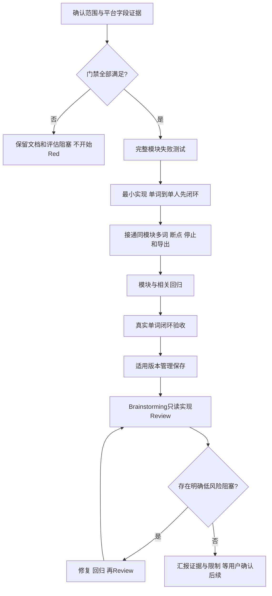

# Instagram 达人搜索实现计划

**Goal：** 在Ego正常页面能力支持下，完成10词/100位停止额度的可恢复找人闭环，逐人提供可追溯依据。
**Architecture：** 本模块独立Ego适配与纯判断，参考TikTok状态机和测试模式，不改其生产代码；不引入服务、付费API或大模型API。
**Tech Stack：** Node.js ESM、node:test、Ego Lite；导出使用项目已安装的Artifact能力，单独本地运行时生成表格。
**Spec：** [设计](2026-10-22-Instagram达人搜索-设计.md)；[先行测试契约](2026-10-22-Instagram达人搜索-测试用例.md)。

执行方式：当前对话内顺序实施，后续使用executing-plans，不开新对话或派发Agent。当前仅计划初稿。Brainstorming需求评审已完成，范围待用户确认；主页/窗口/地区/末页能力门禁未满足，禁止开始Red或产品代码。

## 全局约束和发布

完整规则以设计为准：INS独立run和作者库；固定10天自然日窗口、均播>50000、Bio邮箱、US证据、100位/10词先到；不登录、不沿用TikTok地区/恢复规则，不改CRM/TikTok数据。公开主题入口不等于站内完整搜索，未确认前不作为批量入口。

当前独立项目未发现Git元数据，不在CRM仓库提交外部模块，不擅自git init；开发前再核对实际版本管理状态。有Git时按已有分支/中文提交习惯并隔离当前任务；无Git时如实记录变更和验证，不伪造提交。模块为未发布新入口，回滚为停止入口并保留运行证据，不迁移既有数据。

## Review重点

- 缺Bio不能成为无邮箱，搜索卡片中的文案/email不能冒充当前主页Bio。
- 媒体连接与相关主题连接的cursor/has_next_page不能混用。
- 精确plays与views不得因字段名相近静默合并；没有日期不能推算窗口。
- 公开来源的机构/转载/协作账号仍须按实际发布作者归属，内容命中不保证创作者资格。
- 主题不可用、登录页和短暂无响应都不能标成有效零结果/全词完成。

这些均已落到EMAIL/SOURCE/METRIC/CONTENT/PAGE/ACCESS用例。

## 唯一Task：Instagram达人搜索完整闭环

### 流程图



### 伪代码

```text
require approved scope/spec/test/plan and verified source contracts
freeze config and reject incompatible resume; acquire one writer
for keyword from saved position:
  open approved entry; require actual topic identity
  while valid media connection has_next_page:
    save author + source evidence + media cursor
    normal scroll; wait for relevant response; pause on unknown/protection/stall
  process unique candidates only after explicit media end
  for candidate until target:
    verify current profile ID + complete Bio
    missing -> data_incomplete; access blocked -> save and pause batch
    no email -> rejected
    collect complete dated videos window, validate order/owner/type/exact count
    evaluate arithmetic mean, content and confirmed region semantics
    atomically save author facts then counts and keyword progress
export all unique confirmed/suspected; verify three sheets and evidence
on export failure resume export only; finish original space once after verified output
```

### 注意点

一个Task内可分多步骤，但不拆成独立交付Task。最早可见业务闭环是单词真实作者判定，不以离线夹具通过替代在线验收。能力探测只读，在Red前完成并回写选定来源。用户取消登录持续有效，当前主页转登录时不会自动点击继续。

### 拟新增文件和接口

| 文件 | 职责与接口 |
|---|---|
| config.mjs | normalizeConfig(input, now) -> 冻结配置；assertResumeCompatible(saved, input) |
| browser.mjs | createEgoBrowser({page, task, runDir, config})；discoverBatch({keyword, checkpoint, onCheckpoint})、readProfile、nextPosts 返回已验证来源与缺口 |
| profile.mjs | evaluateCapture({candidate,capture,config}) -> 四种判定、metrics、location、inclusionBasis；地区source contract先确认后定 |
| workflow.mjs | runCampaign({config,runDir,browser,resume,exporter}) -> 进度、真实停止原因、输出；作者/来源幂等保存 |
| find.mjs | 参数校验、dry-run、启动、resume、status、export；未实现前不对外提供可执行用法 |
| export.mjs | exportResults({runDir,results,config}) -> 路径及verification，INS文案/地区语义 |
| *.test.mjs | 与上述文件对应，覆盖测试契约所有离线用例 |

来源协议当前尚有未验证字段，不能仅凭计划直接填猜测接口；确认后在同一套文档收敛，不先写可执行空壳。

### 执行步骤

- [ ] 取得用户对公开主题入口范围及三份文档的确认；验证可用主页、完整窗口、媒体末页和地区证据语义，补公开夹具。此步骤是开发前门禁。
- [ ] 核对版本管理和现有相关基线，确认不修改CRM及旧名单。
- [ ] 按17项契约写完整模块失败测试，观察缺失实现导致Red，保存命令/失败原因。
- [ ] 最小实现配置和来源解析，接通单词到单人流程；EMAIL/METRIC/REGION/ACCESS保证硬条件和暂停行为。
- [ ] 在同一Task补齐顺序、跨词去重、缓存失效、writer、恢复、额度和三页导出。
- [ ] 运行 `node --test scripts/instagram-finder/*.test.mjs`；按实际复用依赖跑受影响TikTok模块回归，所有新增失败修绿。只读参考CRM源码不需要CRM构建或重启。
- [ ] 做真实单词端到端验收，保存入口/作者/窗口/地区/结论证据；若访问阻断则明确未验收，不扩大权限或伪造通过。
- [ ] 在适用的版本管理下保存；随后宣布bounded只读实现Review的范围/输出/停止条件，并使用Brainstorming检查设计/调用链/测试缺口。
- [ ] 明确低风险阻塞按原设计修复，重新测试和Review；其他争议/风险先请用户决定。
- [ ] 报告需求Review、实现Review、自动修复、复验和真实在线边界，等待后续模块或合入确认。

对标回写：范围/条件摘要/地区语义/四类结果及完成原因均属于本Task；不接入第三方服务，不复制受众筛选或默认粉丝门槛。具体来源与缺失信息见需求评审文档。
