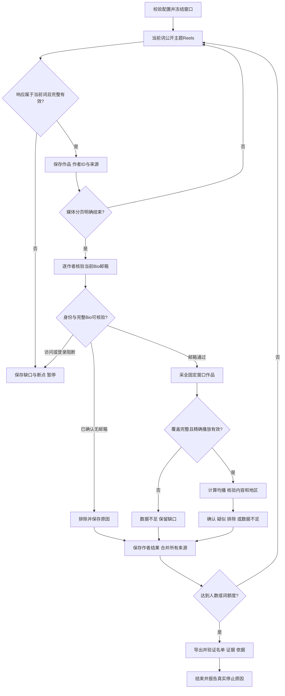

# Instagram 达人搜索设计

## 2026-10-23 搜索入口修订

按用户本轮明确要求，共用 `createSearchPager.first()` 改为官网首页 → 点击搜索 → 输入关键词 → 键盘 Enter。使用官网当前可见搜索控件，不构造关键词结果页导航地址。输入值及焦点确认后提交，等待实际关键词结果地址，并沿用原生响应的关键词关联和分页校验。每个新关键词执行此流程；后续翻页及原断点恢复不重复回首页。登录/验证/限流/控制权异常仍停止，不引入 TikTok 的弹窗关闭或重试规则。

实现范围为搜索入口和说明文档。在线验收发现 Explore 搜索框存在覆盖按钮，已增加仅在按钮可见时先展开面板，再点击输入框。2026-10-23 使用同一新空间111实跑：完成首页导航、搜索入口、展开面板、填写 christian skits 及键盘 Enter；页面显示相关账号，但地址仍为 /explore/，读取响应检测到 instagram_access_stopped_rate_limit 后暂停并交还用户。因此仅确认操作链路，完整关键词结果页及原生结果读取尚未通过在线验收。证据保存于 runs/2026-10-23-ins-search-acceptance。

状态：待用户确认的设计初稿。Brainstorming 需求评审：已完成，存在上线前能力阻塞；不代表可开始实现。评审见同目录平台评估文档。

## 目标与边界

使用 Ego Lite，从有序关键词对应的视频/Reels结果提取作者，平台内跨词去重，核验当前公开 Bio 邮箱、内容方向、完整窗口均播及美国地区证据，交付名单和逐人收录依据。用户已说“跟tiktok”，并取消登录。

保持一个端到端业务模块：采集、资格判断、断点和导出共用作者证据与冻结配置，单独交付其中任意层不能验收找人目标。不涉及 CRM 写回、浏览器插件发布、邮件发送、受众画像、付费数据服务或 TikTok 再采集。无需服务、数据库或新依赖；不重构 TikTok 生产模块。

## 已确认批次规则

有序关键词沿用已完成的 AI 扩展词第一轮：
1. christian sketch comedy
2. bible parody skits
3. jesus skits
4. church comedy
5. christian satire comedy
6. christian POV skits
7. funny bible stories
8. relatable church comedy
9. clean christian comedy
10. christian family skits

基督教主题的短剧/喜剧，允许宗教讽刺；仅内容方向有歧义时可疑似交付，不能推断作者个人信仰。目标100位，最多10个完整词，或唯一 confirmed + suspected 达100位时先到停止。无隐藏粉丝数或最少作品数门槛。

要求本人当前公开 Bio 中明确文字邮箱，不用搜索摘要、联系按钮或站外页面代替。近10个完整自然日，算术均播严格大于50000。时区 Asia/Shanghai；真实批次开始时冻结 [开始,结束) 窗口，恢复不漂移。本次只读评估不启动批次、不沿用旧冻结日期。

目标地区 US。TikTok 的视频创建地区规则没有已验证的 INS 等价字段。每份地区证据必须记录原值、字段路径/公开原文、来源链接、采集时间及语义；Bio地点、电话区号、视频定位、商业地址、账号所在国、创作者居住地不能混同。当前未选定可用于硬条件的地区来源；上线前须实测并确认语义。来源未确认或只有推断时，结果为 data_incomplete，不进入交付人数。

## 入口与权限

推荐方案：使用未登录的 Instagram 公开主题 Reels 页作为候选发现入口，但需用户确认它的检索范围。2026-10-22 实测 church-comedy 可用，christian-sketch-comedy 显示不可访问。该入口是主题精选/热门结果，不是站内所有匹配视频，不能承诺词覆盖率或穷尽 Instagram。

备选：以后用户主动提供可用登录会话时，再验证站内搜索；当前不执行登录。另一个备选是外部搜索引擎，但其范围不同，不自动混入本次流程。不调用 Apify/Modash，仅参考官方产品说明。

不可访问主题标记 unavailable，不计为有效空结果或完整完成词；保留当前词，暂停等用户决定。相关主题建议只展示，不自动替换或追加关键词。取得明确末页只能说明该入口本次可返回的结果结束，不能说明全站结束。

## 数据与流程

搜索适配器只读取正常页面加载/滚动产生的文档和响应。已实测路径为 result.data.xig_logged_out_popular_search_media_info，媒体为 edges[].node，含 code、pk、user.pk、user.username、caption、play_count；page_info 包含 end_cursor/has_next_page。JSON外层 require/bbox 位置可能变化，不写死脚本序号21。相关主题有独立 page_info，不能误当媒体游标。

搜索层未见 Bio 与发布时间，不将它们当作真实空值。作者ID与作品ID保留十进制字符串；shortcode 用于链接，不等同数字ID。仅在当前目标身份及数据完整性已确认时，允许无邮箱排除。

按 platform + authorId 去重，账号改名保留别名；用户名只在稳定ID取得前作临时键。跨词合并所有来源作品/关键词，缓存注明原采集时间，Bio/用户名变化使对应核验失效。不同平台同名不视为同一人。

搜索播放量只为来源证据，不能算作者均播。主页完整窗口需精确发布时间、作者归属、真实整数播放量、作品类型、置顶和排序证据。只纳入目标作者发布的视频/Reels；照片、纯图文轮播不纳入，混合轮播未明确分类时保持缺口。协作作品必须区分发布者与合作者，不把转载者/标记者认作原作者。不凭shortcode推断发布日期，不混用 view_count 与 play_count；先确认实际来源及计数语义，隐藏或缺失不补0。置顶旧作不作为时间边界，按作品ID去重，重复冲突需保留原因。

## 状态、恢复与输出

保存 config.json、execution-state.json、candidate-queue.json、逐作者capture/author记录和results.json。已成功事实先保存再推进阶段；同批单writer；恢复核对配置/空间，只补缺口。继续用空间19/p1，用户控制或访问异常立即停止，不另建恢复空间。

confirmed：所有硬条件与内容均已核验；suspected：所有硬条件通过，仅内容待人工复核；rejected：明确不满足；data_incomplete：必要数据未核实。浏览器保护/登录阻断暂停整批，同时保存当前作者缺口。额度停止与全词完成分开；已核验候选全部保留。

搜索翻页及导航至少10.5秒，主页作品翻页至少3秒，动作串行并等待加载。INS暂不继承TikTok普通403单次重试或30次错误按钮预算；403/401/429、验证或控制丢失先保存暂停，恢复由用户处理后的原状态决定。空批、只见loading、缺响应/正文不可读、游标停滞都不当作末页。

XLSX三页：达人名单、主页证据、视频证据。每人收录依据含Bio邮箱原文、窗口/有效数/精确均播、地区来源语义、内容原文、关键词/作品/主页链接、采集时间及疑点。名单只含confirmed/suspected；排除和不足保留在机器记录及状态摘要。公式独立重算、长ID文本、链接及布局核对后才完成。导出失败只恢复导出。

## 验收与依赖

最早可验收闭环为一个已批准入口关键词，提取至少一位真实作者，核验主页/完整窗口/地区并输出明确结论及依据。只有候选列表或模拟测试通过不等于此闭环验收成功。

进入开发前：用户确认公开主题入口范围及三份文档；实测可取得当前主页Bio和完整作品窗口，确认媒体末页判据与地区来源语义；把所选来源和脱敏公开夹具补回文档。若会话继续限制主页，则保留评估状态，不实现声称可完整筛人的采集器。

线上对标接受：Apify区分搜索类型和入口范围；Modash区分创作者/受众地区，展示已应用条件。本模块采用冻结参数摘要、来源/完成范围明示、地区语义分列、四种结果及暂停原因。排除新增受众画像、粉丝默认门槛、数据库搜索、自动换词和外部服务。具体来源/访问日期及未知交互记录见评审文档；对应测试为范围-SCOPE-001、地区-REGION-001、状态-STATE-001、导出-EXPORT-001。
