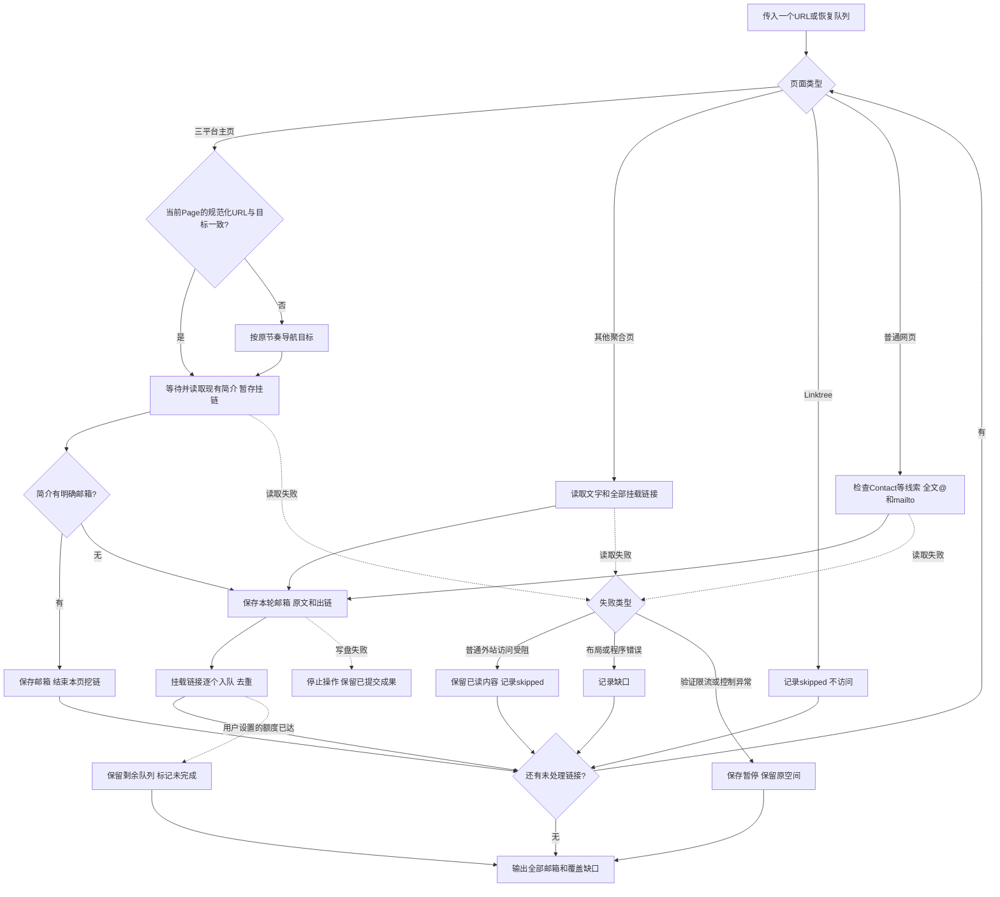

# 主页邮箱递归查找实现计划

**设计：** [设计](2026-10-22-主页邮箱递归查找-设计.md)。**先行契约：** [测试用例](2026-10-22-主页邮箱递归查找-测试用例.md)。**Review：** [需求评审](2026-10-22-主页邮箱递归查找-需求评审.md)。

**状态：** Brainstorming 需求评审：已完成（第三轮）；流程图已确认（2026-10-22）；代码与离线验证、代码Review已完成；Linktree已按用户最新要求暂时跳过，不再阻塞本次交付。

**目标：** 先检查主页简介；有明确邮箱即结束该主页挖链，没有则把挂载链接作为同一流程输入，递归读取公开邮箱和来源；普通网页采用简单的联系线索/@/mailto扫描，不做整站遍历。

**架构/技术栈：** Node ESM标准库、node:test、Ego Lite。一个串行URL队列，一个空间；页面适配器每轮读取后回调保存，纯规则提取与去重，不增加服务/数据库/模型。

## 全局约束

- 当前对话原生执行，一个端到端Task，不另开聊天/默认创建Agent。
- 主页/聚合页的挂载链接逐个检查，不按同一达人或contact过滤；普通网页只继续明确联系/社交主页/聚合入口。
- 默认遍历至队列耗尽，maxDepth/maxPages只有用户显式设置才启用，达到时partial并保存未处理链接。
- 不做普通网页自动滚动、通用展开或复杂身份归属推断。可见已加载正文、线索邻近文本、mailto和@是普通页的全部主逻辑。
- 同页混淆写法独立扫描，不因其他@存在跳过。邮箱明确公开与是否属于最初达人分开，不凭归属未知丢弃地址。
- 单份上下文≤1500字符，单页新增证据≤200000字符/20000文本节点；重复读取不重复计数。
- 每轮有效capture先提取并提交，再做下一步；attempted/已保存/扫描完成分开。单writer，唯一状态提交指针，摘要可重建。
- TikTok导航≥10.5秒，其他导航≥2秒；只有真实阻断才暂停。共享TikTok访问器不能用登录文字替代新适配器的目标可读性判断。
- 输出事实与completion独立；completed且输出已验证才finish自建空间，调用方空间不关闭。
- 2026-10-22补充：readPage先比较传入Page当前URL规范化键；一致时复用现有文档并等待资料就绪，不一致时原样导航。复用后的下一次导航仍执行节奏，地址/控制异常先暂停。借用Page的接入方管理空间生命周期；本次不改两套找人脚本，不新增/reels/归一化。
- 当前独立项目没有.git，不擅自初始化或把文件提交到CRM。若用户以后提供仓库，再按其中文提交/分支习惯交付。

## 文件和接口

相对于scripts/profile-email-finder/：find.mjs负责CLI、启动Ego和help/status/resume；finder.mjs负责URL分派、提取、队列、断点与输出；browser.mjs负责正常页面/平台资料读取和控制状态。两个*.test.mjs测试文件与最小fixtures/留开发及Ego验证证据，README.md描述实际命令与限制，文档保留在docs/。

- classifyUrl(rawUrl, baseUrl?)返回规范化地址、页型/平台，或不支持理由；无网络副作用。
- extractCandidates(capture)返回emails/links/exclusions/issues；页型与来源区决定出链范围，不做自然人身份判断。
- runFinder({config, runDir, browser})执行单队列与恢复；config内两个可选额度默认为null，不从旧方案注入3/20。
- createEgoBrowser({page, task, config})提供readPage({url, checkpoint, onCapture})、finish、handOff；onCapture接收本轮公开内容及阶段，回调完成前不做下一步交互。新适配器先判断目标资料是否正常可读，只有真实TikTok失败才进入共享重试器；不修改共享器。
- main(args)返回0=completed、2=partial、3=paused、1=failed。即使非0也输出已提交事实，不能为了返回成功隐藏缺口。

## Review重点

1. A→B→C中C是另一达人：不能被同人/联系词/图标条件筛掉，见链接-LINK-001/008、提取-EMAIL-010。
2. 普通官网Footer Contact与品牌公用页脚不同；不能一律排除页脚，见链接-LINK-007、联系-CONTACT-001。
3. 同页@用户名与混淆邮箱共存，见提取-EMAIL-007。
4. readPage后续交互失败前已经读到邮箱，见状态-STATE-006；回调写盘失败必须阻止下一步动作。
5. 非遮挡登录邀请不等于登录墙，见浏览-BROWSER-009；共享重试器不代替业务可读性检查。
6. 未完成页已留过证据仍要能恢复，见状态-STATE-005，不能把已访问集合当已完成集合。

## Task 1：完成独立递归查验闭环

### 流程图



### 伪代码

```text
main(args):
  help/status不启动Ego；新任务校验URL和可选额度，恢复核对冻结配置
  取得run-dir单writer锁，读取已提交证据/完成集合/未完成页/待检查队列
  连接本任务原空间
  while 有可执行URL:
    可选额度耗尽 -> 保留队列，partial，退出循环
    URL规范化/重定向判重；成功页复用，未完成页从其检查点继续
    readPage先比较当前Page的规范化URL键：相同则等现有资料，不同则按原节奏goto
    当前地址不可读/控制异常先暂停；复用时为下一次导航记录保守的节奏起点
    readPage({url, checkpoint, onCapture: async round => {
      candidates = extractCandidates(round)
      保存本轮邮箱和来源；主页出链先暂存
      若简介有明确邮箱：保存命中标志，返回stop，不再挖挂链
      若主页最终没有明确邮箱：将暂存挂链入队；其他页照常处理出链
      先写证据版本，再原子提交新状态；随后才允许下一步交互
    }})
    整页结束才标扫描完成；普通单页失败保留partial并继续
    真正保护/登录墙/控制或浏览器问题 -> 保存paused，退出循环
  从已提交状态重建结果，输出邮箱/来源/未检查链接和停止原因
  completed且自建空间 -> finish一次；partial交还保留；paused不finish
  释放锁并返回真实退出码
```

### 注意点

- 完整54条契约构成一个模块Red，不拆成按平台分别交付的Task。
- 普通页面不加自动滚动/通用DOM组件识别等重型扫描器；无法覆盖的内容如实留缺口。
- 每次onCapture成功保存后再继续交互；不能等readPage整页成功才保存，也不能写盘失败后继续。
- 不能复用旧找人的“Bio无邮箱直接排除”；本模块必须继续挂载链路。
- 恢复失败/部分页不能重置保护预算，也不能重采所有已完成页；固定范围不支持的问题不靠resume反复空转。
- 准确区分公开出现、格式歧义、来源页面、文字线索及未认证归属，不伪造“本人邮箱”。

### 实现步骤

- [x] 用户确认收敛后的三份MD与流程图，登记确认时间后进入Red。
- [x] 基线：node --test scripts/tiktok-browser/access.test.mjs scripts/tiktok-video-region/region.test.mjs scripts/tiktok-search/search.test.mjs scripts/tiktok-finder/*.test.mjs，记录实际结果，不顺手修旧模块。
- [x] Red：按全部有效编号编写node测试与Ego最小DOM夹具；node --test scripts/profile-email-finder/*.test.mjs，确认因新行为缺失而失败。协议替身不冒充真实DOM验证。
- [x] Green：最小实现分类/提取/队列与保存，再接Ego资料读取和CLI；不增加模型、数据库、搜索或通用网页扫描框架。
- [x] 模块验证：node --test scripts/profile-email-finder/*.test.mjs；node --check逐个检查三生产文件；help/status验证不启动浏览器。
- [x] 相关回归：重跑选定基线。没有改CRM后端/扩展，不运行无关服务重启与构建。
- [ ] 二次验证：三平台各一真实主页、一个聚合页/普通Contact页、A→B→C跨账号链路；核对原文、来源、去重和未检查项，分别记录实际在线通过/受阻。
- [x] 更新本模块README与项目索引。没有Git就如实报告没有提交；用户提供仓库后按规则先提交再实现Review，不初始化其他仓库。
- [x] 宣告范围、格式和停止条件后执行Brainstorming bounded只读实现Review；逐项报告缺陷及用户影响。明确低风险修复后复验/再次Review；主流程/中高风险争议先等用户决定。
- [x] 最终报告实际测试命令、Review方式/范围/结论、独立Reviewer是否做、逐项修复及在线限制；不自动扩展其他模块或合入master。

### 实际交付状态（初始交付历史；最新规则见补充章节）

77项模块测试、语法与CLI help/status通过，真实CLI经Ego子进程重建已完成快照通过，未创建空间。原128项基线在当前143项回归中均通过，新增8项first-n/导出用例失败，本Task未改对应文件。

三平台和普通网页分别验证；Linktree完整在线仍受阻，二次验收项保留未完成。代码Review及修复后再次Review完成；独立Reviewer未做。无Git故没有提交；无CRM代码改动，无需构建或重启。逐项修复见[开发验证与实现Review](2026-10-22-主页邮箱递归查找-开发验证与实现Review.md)。

## 2026-10-22 补充：外站受阻跳过

用户明确规则修正：“普通网页访问受阻就忽略，最近Linktree都无法访问，可以先忽略跳过”。本次为同模块、边界明确的小范围规则修正，直接修改并同步原文档，不新建模块或重复流程图确认。

- Linktree精确主机linktr.ee/www.linktr.ee在队列内直接记skipped，不调用页面读取；普通短链跳转到Linktree也不读取其DOM。
- 普通外站导航失败、HTTP错误和外站登录墙记录skipped及原因，不重试，继续其余分支；已提交邮箱照常输出。
- skipped是终态，续跑不重新入队；completed允许包含已明确跳过的页面，不等于所有网页均已读取或都没有邮箱。
- 验证码、429限流、平台真实阻断、用户接管、CDP/页面无响应和写盘失败保留原暂停/停止规则；程序错误不冒充访问受阻吞掉。
- 新增SKIP-001/002/003、BROWSER-015/016/017并调整STATE-001、BROWSER-008/010；递归/环/长链夹具改用Beacons，Linktree另测主动跳过。
- 模块83/83通过，相关回归152/152通过，node --check通过；Red/Green及最新回归见validation/skip-*.log。本轮未再次访问Linktree。

## 2026-10-22 补充：简介邮箱优先

用户明确修正规则：“如果一个主页简介里直接就读到了邮箱，就没必要再去挖掘链接里的；如果简介里没有，又有链接，那就继续挖掘。”主页简介有明确邮箱时立即输出该主页结果，不再挖掘其挂链；没有明确邮箱时才沿挂链继续。疑难候选不算命中，每个递归遇到的主页都适用。

主页出链每轮先保存在pendingProfileLinks中，不提前进入访问队列；只有本页没有明确Bio邮箱才在页面读取结束后入队。明确命中需同一份profile_bio证据为confirmed_public，不能用挂链标题、mailto证据或同地址聚合后的状态冒充。普通网页/聚合页扫描与外站受阻跳过规则沿用。

命中后先保存邮箱/证据及bioEmailFound，再向采集器返回stop；每轮正常展开、超时后观察、重试后的读取都遵守停止信号。已提交命中后中断，续跑可直接完成本页；没有命中时，暂存链接在续跑后仍能进入队列。bool标志须校验类型。

验证：BIO-001到009与既有用例合计92项通过，相关回归154项通过；三平台真实Chromium DOM夹具区分Bio与挂链文字通过；TikTok当前公开样本实际完成1页、0条跟进链接，见validation/bio-first-online.log及bio-first-online-run/results.json。
