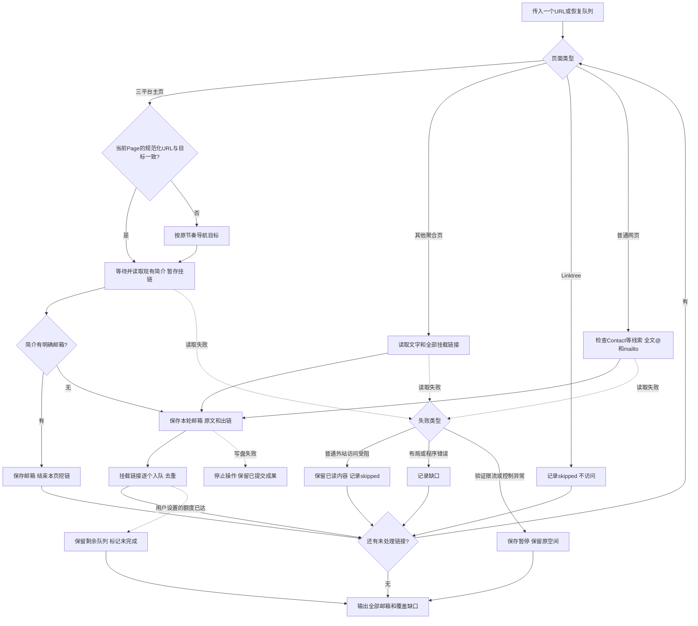

# 主页邮箱递归查找设计

状态：Brainstorming 需求评审：已完成（2026-10-22第三轮，已按用户两次澄清修正）；流程图状态：已确认（2026-10-22，用户“继续下一步”）。Task 1代码与离线验证已完成，代码Review已完成；Linktree已按用户最新要求暂时跳过，不再阻塞本次交付。详见[开发验证与实现Review](2026-10-22-主页邮箱递归查找-开发验证与实现Review.md)。

## 已确认目标

用户输入一个URL，先检查主页简介。有明确邮箱则输出并结束该主页挖链；没有明确邮箱才继续其挂链。A无邮箱且挂B、B无邮箱且挂C时，A、B、C各自按同一流程处理。不是关键词搜索、站内搜索或搜索引擎找人，也不按是否属于最初达人来排除其他主页。

用户已确认放在creator-finder内作为独立脚本；纯脚本规则，不调用模型API。普通网页只围绕contact及相关词、@、email/mailto/emailto线索找邮箱，不做复杂的整站遍历。

一个端到端业务模块、一个完整Task：读取页面→提取邮箱/挂载链接→去重递归→保存来源→输出。不会为每个链接创建一个独立任务、Ego空间或运行目录。

## 2026-10-22补充：复用当前已打开的页面

用户明确要求兼容接入方已经打开目标主页的情况，本次按同模块小范围规则修正直接实施。读取前比较传入Page当前地址与目标的现有规范化URL键；一致时直接等待并读取当前文档，不重新goto或刷新，不一致时沿用原导航及异常处理。主页尾斜杠与普通锚点按原规范化复用，query、路由片段及不同账号仍区分；不跨标签页寻找页面，不新增/reels/归一化规则。

复用不等于跳过资料就绪/真实访问阻断检查；读取地址或控制异常即暂停。复用后若访问下一页，从当前观察时点保守执行原有导航间隔。简介命中、展开、保存、递归和断点规则保持。

接入方传入现有Page并管理空间生命周期；借用适配器可不传task，正常返回后继续均播/国家核验。外链递归仍可能离开原主页，后续工作由接入方串行安排并恢复所需页面。本次未接入INS/TikTok查找，也未修改其资格口径。无新增界面，线上对标不适用；验收为三平台协议测试、原导航回退/控制/节奏回归及真实Instagram无重载证明。

## 页面分派与递归边界

| 输入类型 | 当前页检查 | 哪些链接继续套用同一流程 |
|---|---|---|
| TikTok、YouTube、Instagram主页 | 优先读取当前账号简介/About；Bio中已有明确邮箱时结束本页挖链 | 仅没有明确Bio邮箱时，才处理资料区实际挂出的HTTP(S)链接和文本网址；邮箱链接直接解析。不限是否同一达人，不以contact为前提 |
| Linktree、Beacons等链接聚合页 | 当前公开文字、联系块、mailto与主体链接列表 | 主体列表实际挂出的链接逐个继续，不按收件主体或是否含contact筛掉 |
| 普通网页 | 当前已加载的可见正文；contact等线索附近文本；全文@及mailto | 只继续明确的联系入口、三平台主页或已识别聚合页。普通导航、文章、商品、广告等不做整站递归 |
| 三平台视频/帖子/其他非主页页 | 只辨认页型和是否存在明确的公开作者主页链接，不抓作品详情/评论、不从用户名猜作者 | 存在明确作者主页链接才作为新输入；不能辨认则保留未支持链接/缺口，不伪称已查完主页 |
| mailto或非网页协议 | mailto解析邮箱；emailto作为线索/非标准写法保留候选，不启动外部应用；其余协议记录不支持 | 不调用邮件客户端、不提交表单、不下载文件 |

三平台主页按精确主机和路由识别：TikTok /@账号，Instagram /账号/，YouTube /@handle、/channel/ID、/c/名称、/user/名称。不能把伪造子域名、搜索、登录、视频或Shorts误认成主页；无法识别的布局保留缺口。省略https时只对明确三平台/聚合主机或www网址补协议，不猜测任意文字。

普通网站自己的页脚Contact链接和邮箱仍在检查范围内。聚合服务的品牌页脚、平台导航不是创作者挂载列表，不扩成递归；若其文字中命中邮箱，保留来源位置/上下文，不冒称为达人本人邮箱。普通网页的社交链接不要求一定是图标，文字按钮、锚点和明确文本URL同样识别。

## 普通网页的最小处理规则

1. 等待当前目标的正常正文或链接加载；获取当前已加载、渲染可见的文字和链接，包括屏幕外但已经加载的正文。排除script/style/template、隐藏模板、输入占位示例等。
2. 不分大小写匹配contact：包括Contact、CONTACT、ContactTo、Contact to、Contact-us、/Contact和编码形式；补充email、e-mail、emailto、business、booking、management、collab、inquiries、get in touch、reach out、合作、联系等简单词表。线索用于定位附近内容，不作为邮箱提取的必要条件，不证明邮箱归属。
3. 对线索节点取同一段/列表项/联系块及前后相邻文本；同时扫描全文@，避免没有contact时漏邮箱。每份上下文最多1500字符，超长内容围绕命中位置截取，不把整个body称为“同块”。
4. 检查可见mailto锚点的href，包括只有邮件图标/自定义标题的情况。按字段解析路径与to收件人；cc/bcc保留为抄送候选；subject/body中的地址不冒充收件人。只解码一次，保留+tag和原始链接，不唤起系统邮件应用。
5. 明确的[at]/[dot]写法与普通@扫描独立执行；页面其他地方有@也不跳过混淆写法。混淆、黏连、需要删除空白才能还原或规则不支持的复杂地址都保留原文并列待复核，不猜邮箱。

首版不做普通网站的自动滚动加载、通用折叠/弹窗识别、iframe遍历、OCR或PDF解析。平台简介/链接展开与聚合页明确的联系详情可以按已支持的页面适配读取；无法读取的联系入口保留缺口。不得以“整个网页”宣称覆盖了尚未加载的内容。

单页最多处理200000个已收集字符与20000个可见文本节点；同一轮/多轮重复读取的相同证据不重复扣额度，新增或改变的内容照实留证。若有工具截断、未完成加载或明确无法读取的联系入口，结果标partial，不以缺失内容证明没有邮箱。

## 邮箱结果与来源

- 正常邮箱清理确定的零宽/全角格式变体，保留原文、大小写、+tag及转换记录；用小写键去重但不丢大小写变体和来源。
- confirmed_public只代表该地址在当前被检查页面明确公开出现；不表示可投递、不认证自然人归属，也不表示属于最初输入达人。
- needs_review用于邮箱边界/写法不清、混淆还原或非标准链接等歧义。邮箱归属unknown本身不是丢弃地址、停止递归或将明确公开地址降级的理由。
- contacttofoo@example.com不擅自删contactto前缀；原样候选和黏连疑点一起保存。@用户名、CSS、文件名和占位示例不冒充联系邮箱。
- 每次出现先独立留证，再聚合同一地址；不同页面的本人/经纪/客服/未知语境全部保留。可以标注原文中明确的Management/Support等线索，不用纯规则伪装成已认证的身份判断，也不因重复出现就提高可信度。

每个结果包含email、公开/待复核状态及原因、发现页、页面类型/账号或标题、命中原文与上下文、位置、原始href或文本网址、发现路径和采集时间。所有来源可回溯到最初输入；其他达人或网站邮箱也按各自页面归档，不混成“输入达人本人邮箱”。

## 队列、额度与恢复

所有接受的URL复用同一串行队列和Ego空间。默认按发现顺序广度优先遍历至队列耗尽，不再默认用3跳/20页截断“逐个检查”的目标；可选maxDepth/maxPages只用于用户主动设置有限运行，达到后是partial，保留剩余链接，不能报告全部完成。根深度0；有值时maxDepth允许非负整数、maxPages必须是正整数。

运行入口：`node scripts/profile-email-finder/find.mjs --url <URL> --run-dir <绝对目录> [--space <本任务ID>] [--max-depth N] [--max-pages N]`。`--resume --run-dir <目录>`继续原任务；`--status`/`--help`不启动浏览器。入口已实现，使用方法见[模块README](../README.md)。

相对URL按当前页解析。去重保留有意义的query和路由片段；不删query参数、不重新编码原导航地址，不因文字看起来相似合并不同页面。同页普通锚点复用本页已读内容，#/或#!/路由保留；重定向记录原URL/最终URL、重新分类及判重。只接受公开HTTP(S)或直接可解析的邮箱信息，排除凭证URL、明显本机/私网地址和危险协议。

attempted、内容已保存和页面扫描完成是不同状态。未完成页的证据可以保存，但不能放进“成功完成、永不再检查”的集合。恢复仅继续当前未完成阶段和剩余链接；已经成功完成的页面复用原采集快照并保留时间，不冒称重新验证了当前邮箱。用户设置的页数/深度额度仍耗尽时，明确要求提高对应额度，不允许原地空转；固定文字/不支持入口的缺口可保留待人工复核，不承诺仅执行resume就能解决。

## 保存顺序与失败处理

平台展开或聚合页分段读取采用readPage(..., onCapture)：每获得一轮有效内容就提取并提交邮箱、出链和页面阶段，再做下一次展开/导航。之后发生超时、验证码或控制丢失，之前已经提交的本页邮箱仍输出；不能直到整页成功后才首次保存。

execution-state.json是唯一提交指针，包含队列、已完成页与各未完成页检查点。证据先写不可变版本，再原子rename更新状态；pages.json/results.json是可重建摘要。孤立证据不算已提交；指针更新后摘要失败可只重建输出，不重新访问成功页。单run-dir只允许一个writer，写盘失败立即停止后续浏览器操作并保护旧成果。

completion与邮箱事实分开：completed表示声明范围内接受的链接都已检查且没有未决缺口；partial表示单页不可读、用户额度、截断/不支持等；paused表示需要用户或浏览器恢复；failed表示输入/存储/状态错误。任何状态都保留已提交邮箱，completed+零邮箱仅代表本次声明范围未发现。

- 普通外站访问受阻（404、401/403、超时、连接失败或外站登录墙）：记录skipped和原因，不重试，继续其他公开分支。Linktree直接跳过。
- 验证码、429/明确限流、平台登录墙挡住目标资料、用户接管或Ego/CDP异常：保存并暂停原空间。页面上有登录按钮/登录邀请不等于无法读取；公开目标资料正常可读时应继续。
- 普通超时先看原页实际内容；可用则继续，普通暂时错误最多原址重试一次。TikTok确实失败时可复用项目现有普通403等待11秒一次重试、明确错误页可见按钮等待至少10秒且累计最多30次的规则；先辨认目标公开内容与真实阻断，不能仅凭页面出现登录文字误停，也不改共享访问器已有语义。
- TikTok导航沿用至少10.5秒，其他导航至少2秒，动作串行并等待明确内容；进度包含正在检查的URL、阶段与重试次数。
- 新建空间仅在completed且结果输出验证后finish一次。partial交还保留，paused/异常不finish；调用方空间不擅自关闭。恢复使用原空间并遵守Ego控制权。

## 非目标与验收

不发邮件、不验证收信、不搜索候选、不建数据库/界面/定时任务、不改现有找人邮箱资格、不回写CRM，不重采历史名单。首版控制台和JSON输出，不新增表格导出。

验收必须包括：A→B→C分别处理且跨账号不被筛掉；普通网页只走简单关键词/@/mailto流程而不全站扩张；同页同时有@提及与混淆邮箱；网站自己的Footer Contact与文字社交链接；本页先得邮箱后受阻仍保存；恢复补未完成页、不重采成功页；可选额度不冒充完成；三平台分别真实读取才可宣称在线可用。离线夹具不替代真实Ego/平台验收。

## 用户主流程

流程图状态：已确认（2026-10-22，用户“继续下一步”）。第三轮问题、来源和文档回写见[需求评审](2026-10-22-主页邮箱递归查找-需求评审.md)。对标继续采用已核对的YouTube About/公开邮箱入口与Linktree链接/邮件图标/联系详情；不引入外部服务或表单提交。

## 实施收敛与验证（2026-10-22）

三平台资料及普通页面已分别实测；Linktree完整在线仍受阻。原128项基线在当前143项回归中均通过，新增8项前N位/导出用例失败，不能称全量通过。

- YouTube About用原生按钮Enter；展开超时先观察/提交，原按钮最多再试一次。Instagram已打开链接弹窗直接读取。普通网页不增加通用展开。
- 仅对精确TikTok /link/v2 的target、YouTube /redirect 的q、Instagram l.instagram.com 的u解包明确目标并保留原链接，其他query不猜目标。
- 有界匹配处理长@段落；异常点号列待复核，mailto解码一次仍不能解析时留缺口。透明隐藏文字、table和BR边界经真实DOM验证。
- 断点先校验引用；完成别名立即stop；已关闭成功任务只重建摘要；证据保留页型/标题和不同context。

全部发现、修复和复验见[开发验证与实现Review](2026-10-22-主页邮箱递归查找-开发验证与实现Review.md)。

## 2026-10-22 补充：外站受阻跳过

用户明确规则修正：“普通网页访问受阻就忽略，最近Linktree都无法访问，可以先忽略跳过”。本次为同模块、边界明确的小范围规则修正，直接修改并同步原文档，不新建模块或重复流程图确认。

- Linktree精确主机linktr.ee/www.linktr.ee在队列内直接记skipped，不调用页面读取；普通短链跳转到Linktree也不读取其DOM。
- 普通外站导航失败、HTTP错误和外站登录墙记录skipped及原因，不重试，继续其余分支；已提交邮箱照常输出。
- skipped是终态，续跑不重新入队；completed允许包含已明确跳过的页面，不等于所有网页均已读取或都没有邮箱。
- 验证码、429限流、平台真实阻断、用户接管、CDP/页面无响应和写盘失败保留原暂停/停止规则；程序错误不冒充访问受阻吞掉。
- 新增SKIP-001/002/003、BROWSER-015/016/017并调整STATE-001、BROWSER-008/010；递归/环/长链夹具改用Beacons，Linktree另测主动跳过。
- 模块83/83通过，相关回归152/152通过，node --check通过；Red/Green及最新回归见validation/skip-*.log。本轮未再次访问Linktree。

## 2026-10-22 补充：简介邮箱优先

用户明确修正规则：“如果一个主页简介里直接就读到了邮箱，就没必要再去挖掘链接里的；如果简介里没有，又有链接，那就继续挖掘。”主页简介有明确邮箱时立即输出该主页结果，不再挖掘其挂链；没有明确邮箱时才沿挂链继续。疑难候选不算命中，每个递归遇到的主页都适用。

主页出链每轮先保存在pendingProfileLinks中，不提前进入访问队列；只有本页没有明确Bio邮箱才在页面读取结束后入队。明确命中需同一份profile_bio证据为confirmed_public，不能用挂链标题、mailto证据或同地址聚合后的状态冒充。普通网页/聚合页扫描与外站受阻跳过规则沿用。

命中后先保存邮箱/证据及bioEmailFound，再向采集器返回stop；每轮正常展开、超时后观察、重试后的读取都遵守停止信号。已提交命中后中断，续跑可直接完成本页；没有命中时，暂存链接在续跑后仍能进入队列。bool标志须校验类型。

验证：BIO-001到009与既有用例合计92项通过，相关回归154项通过；三平台真实Chromium DOM夹具区分Bio与挂链文字通过；TikTok当前公开样本实际完成1页、0条跟进链接，见validation/bio-first-online.log及bio-first-online-run/results.json。
