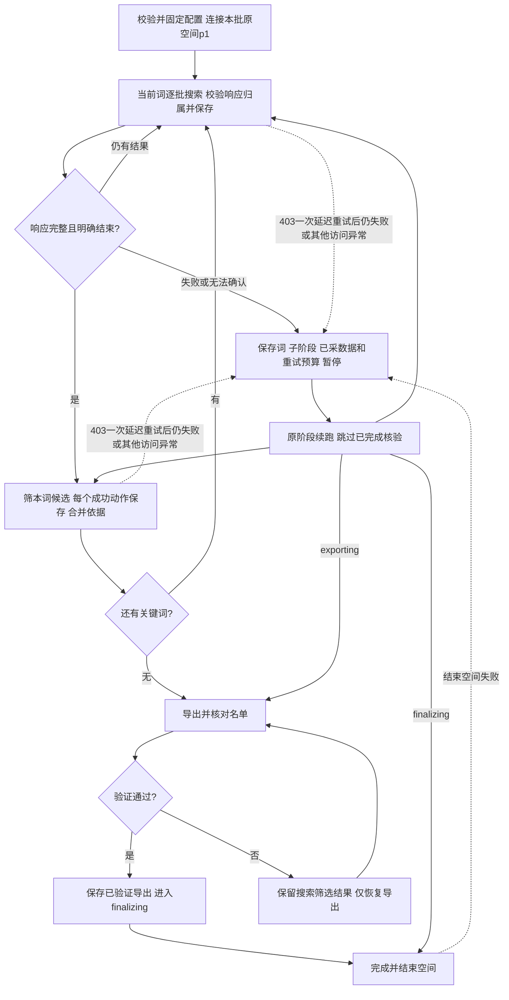

# 多关键词顺序查找实现计划

> 执行方式：当前对话内顺序实施，使用executing-plans；不另开对话、不派发子Agent。遵循按模块交付的一个模块一个Task，流程图确认后才开始Red。若独立项目未纳入Git，不冒充已有提交；先核对目标项目的实际版本管理方式，不在CRM仓库提交这些项目文件。

**Goal：** 有序关键词逐词搜完、筛完再切词，跨词复用事实并最终交付去重名单和依据。

**Architecture：** 外层统一入口冻结任务配置，调用现有单词搜索、通用化的主页/视频采集及地区模块；workflow集中维护逐词阶段与作者结果。Ego是唯一浏览器适配层，确定性规则和模板不调用大模型API；导出复用现有表格能力。

**Tech Stack：** Node.js ESM、node:test、Ego Lite、既有纯筛选逻辑和Artifact Tool。无新服务、数据库或第三方采集依赖。

**Spec：** [设计](2026-10-21-多关键词顺序查找-设计.md)。**先行测试契约：** [测试用例](2026-10-21-多关键词顺序查找-测试用例.md)。

本次[脚本流程Review](2026-10-21-脚本操作流程Review.md)已补齐实现前必须处理的缺口；后续已完成统一入口及旧搜索器必要修复，真实在线新批次未验收。用户确认超目标全部导出、只放宽内容方向。

## 全局约束

- 全词完成才正常结束；targetCount不提前终止。短语完整、有序、稳定去重。
- 统计窗口在创建时按Asia/Shanghai完整自然日固定，恢复不移动。
- 同一Ego空间、显式复用初始p1、单进程串行；搜索结果翻页至少10500ms，主页作品翻页至少3000ms，主页打开/排序/地区详情等其他动作至少10500ms。普通403原址11000ms一次重试，预算持久化不重复；地区详情同页时reload一次，不同页只导航目标视频。任一阶段若快照确认浏览器403或Ego拦截错误页且有可见“重新加载”按钮，每次重试均先等待至少10秒，点击一次并检查结果，最多30次；`checkpoint.retry.screen`和`reloadClicks`随当前动作保存，恢复时保留错误页原址并继续剩余次数，不改用URL重导航。恢复、验证码/登录提示、按钮消失或控制权异常即停止，Please wait等待5秒复查。已观察到的401/429优先停止。
- 搜索完且候选有阶段结论后才推进；正常字段缺失记录缺口，浏览器访问/控制错误暂停整批。
- confirmed与suspected均可交付、分开统计；不得把字段缺失写成已验证。
- 必需Bio邮箱可先用搜索响应`author.signature`预筛：空简介或无邮箱且没有尾部省略标记时记录明确排除并跳过主页；疑似截断或有邮箱提示时仍打开主页核验。标记启发式抓不到静默截断，结果必须如实说明未核验主页；同批已核验Bio邮箱缓存优先复用。
- 均播比较使用配置门槛，不沿用原包写死的50000；同ID且作者/日期一致的多次观测保留来源并按最新有效值统计。country=null不额外取地区。
- 不修改历史任务、原包归档或CRM业务代码；保留现有单词调用默认行为。
- 代码实现前流程图必须经用户确认；一个Task内完成Red→Green→模块测试→相关回归→实现Review。

## 文件与职责

文档按用户指定集中在 `scripts/tiktok-finder/docs/`；设计、测试用例、实现计划及其配套Review始终同目录维护。

| 文件 | 责任 |
|---|---|
| `scripts/tiktok-finder/find.mjs` | 配置文件/空间/运行目录入口、dry-run、resume及执行结果；未实现前不作为可用命令宣传 |
| `scripts/tiktok-finder/config.mjs` | 参数校验、短语/顺序处理、固定窗口与恢复一致性 |
| `scripts/tiktok-finder/workflow.mjs` | 逐词searching/filtering/completed、总目标提示、检查点、阶段导出 |
| `scripts/tiktok-finder/profile.mjs` | 搜索简介邮箱预筛、可疑截断复核、主页邮箱及作品窗口采集、内容候选判定；不改原包 |
| `scripts/tiktok-finder/export.mjs` | 泛化现有表格生成器，来源关键词、复核状态、依据与导出验证 |
| `scripts/tiktok-finder/*.test.mjs` | 按测试契约验证完整业务闭环；使用注入浏览器/时间/存储隔离真实站点 |
| `scripts/tiktok-search/search.mjs`及测试 | 最小接入：可选关闭目标提前返回、每词断点与响应归属隔离、部分响应失败不能耗尽、混合HTTP状态优先级；提取不抢占外层状态的单批适配，旧CLI默认保留 |
| 现有access、region模块 | 优先复用；如接入发现缺陷，先用失败测试复现，再作本模块必要修正 |
| 项目README及本模块三份MD | 更新入口和最终验证/Review记录，不宣称未做的在线验收 |

## Review重点

错误页恢复的现场补充：先将Ego快照的独立`text`节点还原为可匹配文本，不要求标题词之间有空格；使用原站真实失败页夹具验证。搜索/主页/翻页及地区续跑须先确认是否有支持的可见按钮，再判断普通403预算是否耗尽。地区模块统一负责保留`videoRegion.navigationAttempts`和计算剩余按钮次数，浏览器适配层不再提前截断该步骤；执行前必须覆盖已用0/3/10/30次的恢复用例。

1. 达到人数时仍继续k2/k3，且k1筛选未完成不切词：顺序-SEQ-001/002。
2. 空结果、没响应、停滞与未完成分页的区别：完成-DONE-001/002、分页-PAGE-001。
3. 同作者改名/跨词新增证据，不丢新依据或重复采集：去重-DEDUP-001、复用-CACHE-001。
4. 中断恰好发生在作者结果与词指针写入之间：落盘-STORE-001、恢复-RESUME-001。
5. 导出失败不能重爬、内容疑似不能伪全达标：导出-EXPORT-001/002、内容-CONTENT-001/002。
6. 首屏成功但下一页失败、地区前中断、强制退出：恢复-RESUME-002、落盘-STORE-002；保存发生在下一动作之前。
7. 迟到的旧关键词响应、部分响应失败、429与403混合：来源-SOURCE-001、完成-DONE-003、访问-ACCESS-003；旧代码已离线复现误判。
8. 作品分页重试、外层状态所有权、只有p1的新空间：访问-ACCESS-004、集成-INTEGRATION-001、空间-EGO-001。

线上对标接受数组输入、逐项完成、终止条件及阶段展示，已落实以上用例；不接Apify/n8n，不引入并发或默认Top范围。来源与访问日期详见设计评审章节。

## Task 1：完成可恢复的多关键词查找闭环

### 流程图



R按resumeStage选一路返回，不并发。设计文档中的详细流程图为主，均已于2026-10-21获用户确认。

### 伪代码

```text
load and validate config; freeze or verify saved window/order
refuse another live execution of this batch
connect recorded Agent-owned space and explicit work page p1
workflow alone owns batch lifecycle; internal discover adapter does not relock it
for keyword from saved currentKeywordIndex:
    while this keyword search is not explicitly exhausted:
        response = discoverBatch(keyword, its own checkpoint)
        require current keyword/navigation provenance and all relevant bodies valid
        merge author candidates and all source evidence; persist
        on protection/error/stall: save current stage and return paused
    for candidate discovered for this keyword:
        use saved verified facts; only collect unfinished facts
        persist successful bio/first page/every later page and retry budget before next action
        evaluate with all captured relevant evidence
        persist confirmed/suspected/rejected/data_incomplete and reasons
    persist keyword completed; advance index last
export unique confirmed + suspected; verify formulas/evidence/identifiers
on export failure: save export_failed, preserving completed keywords
only after verified export mark completed and finish original space
finally persist not running and clear active PID
```

### 注意点

- 不用内层旧target逻辑决定外层结束；显式关闭本次调度调用的提前退出，默认兼容旧单词调用。
- 每词保存自己的搜索状态；不能用上词游标或API缺失判断下词已完成。
- 一作者一结果，多关键词来源追加；已有核验事实复用，内容结论允许被新证据更新。
- 发布作品覆盖、作者一致、0/未知、照片排除和最新视频地区验证不因内容放宽而省略。
- 只做当前Task；测试/Review闭环后暂停，不擅自执行新的业务搜索或恢复旧50人任务。

### 接口

- `normalizeConfig(input, now) -> frozenConfig`；`assertResumeCompatible(saved, input)`。
- `runCampaign({config, store, browser, onProgress}) -> {status, counts, stopReason, output}`。
- `browser.discoverBatch({keyword, checkpoint}) -> {candidates, evidence, hasMore, checkpoint}`。
- `qualifyCandidate({candidate, config, cachedCapture, checkpoint, onCheckpoint}) -> {facts, decision, evidence, missing, capture}`；成功动作后通过onCheckpoint持久化子阶段、已采页、nextAction及403预算。
- `exportResults({runDir, results, config}) -> {path, verification}`。
- workflow直接提供配置、候选、作者结果、逐词检查点的读取和原子单文件写出；多文件恢复依赖结果先写和幂等，不能声称跨文件事务。
- workflow独占总状态，单批发现适配不再次检查/改写其运行标志；旧runSearch CLI包装保留原生命周期，不能通过暂时清标志来嵌套执行。

### 执行步骤

- [x] 1. 核对本项目版本管理和当前状态；执行现有access/search/region测试建立基线。历史44/44只作历史，使用当时实际输出记录基线，不修改CRM分支。
- [x] 2. 按测试契约先写完整模块失败测试。先覆盖两个词各两阶段、target已满足仍继续、跨词重复作者和403暂停，再覆盖窗口、模糊收录、落盘与导出失败；确认失败因为功能缺失。
- [x] 3. 最小实现config与workflow，注入假浏览器/时间/存储，使顺序、断点、重复执行和空态用例转绿。不要先写完整网页适配再补测试。
- [x] 4. 从真实片段提取profile适配并调用旧搜索/地区模块；泛化任务参数和内容候选判定，完成原始快照回放及字段缺失场景。全程不需要大模型API。
- [x] 4a. 在指标-METRIC-003、地区-REGION-002的失败测试保护下，去除通用模块对原包固定门槛/重复播放冲突判定的依赖；原包保持不变。核对最新有效观测与每条来源时间，禁止重复累加。
- [x] 4b. 将本次Review的10项用例先转成失败测试，再修复搜索来源/完成误判和混合HTTP状态，接入作品分页403预算、账号内逐页断点、单页Ego及状态所有权；区分已知0作品与数据缺失。不能仅增加新外层循环而保留这些缺陷。
- [x] 5. 泛化现有XLSX导出，核对来源词、状态、依据、样本数/均播、长ID和每个sheet预览；将导出失败恢复用例转绿。
- [x] 6. 运行 `node --test scripts/tiktok-finder/*.test.mjs`，再运行 `node --test scripts/tiktok-browser/access.test.mjs scripts/tiktok-search/search.test.mjs scripts/tiktok-video-region/region.test.mjs`；如复用逻辑有改动，补跑受影响原包回归。所有新增失败必须修绿。
- [x] 7. 执行入口dry-run及真实快照的两词离线联调，核对状态事件顺序、最终唯一作者和无浏览器/模型请求。没有新实际采集授权或任务参数时，不用示例词启动真实TikTok采集；在线状态如实列未做。
- [x] 8. 在目标项目适用的版本管理下保存本Task；已是Git才按项目中文提交习惯提交，未纳管如实报告不造提交。随后做Brainstorming bounded只读实现Review，提前声明范围/输出/停止条件。只自动修复明确低争议且不扩范围的问题，发生修复后复验并再次Review。
- [x] 9. 回写文档、实际命令和结果，报告代码Review、独立Reviewer是否做过、发现和自动修复、线上验收边界。质量收口后停在本模块，等待用户下一步；不自动合入master。

## 当前状态

三份MD需求评审：已完成（本次脚本流程复查后回写；两项业务口径已获用户确认）。流程图：已确认（2026-10-21）。初始实现Task已完成Red→Green→回归及两轮Brainstorming有界只读实现Review；后续在线验证发现并修复排序状态竞态，见[测试契约SORT-001](2026-10-21-多关键词顺序查找-测试用例.md)与[验证/Review记录](2026-10-21-开发验证与实现Review.md)。当前可见错误页重载规则已扩展到所有查找阶段；普通API 403仍保留同址单次重试。批次恢复后再次暂停在HTTP 403，当前在线状态见实现Review记录。独立Reviewer/PR Review：未做。

### 2026-10-21 错误页按钮重试次数更新（历史，现行规则见下方）

- 任一阶段的页面快照确认`HTTP ERROR 403`或`ERR_BLOCKED_BY_CLIENT`且有可见“重新加载”按钮时，启动按钮流程；每次先等待至少11秒，再点击一次并检查页面，最多10次，按钮仍在且未受保护才继续。
- 页面恢复立即结束；出现验证码或登录提示、按钮消失、控制权异常则停止；`Please wait`等待5秒复查。按钮循环内逐次等待至少11秒，不能只依赖调用方的3秒或10.5秒节奏；搜索和主页翻页仍按各自间隔执行。
- 这项十次上限只适用于存在可见按钮的浏览器错误页，不扩大搜索、主页、分页的普通API 403单次延迟重试预算。
- 实现落在共享`access.mjs`，由所有导航调用统一识别；`access.test.mjs`、`browser.test.mjs`和`region.test.mjs`验证上限、断点恢复、提前成功、挑战停止、等待页恢复及运行报告记录。
- 复验：两个脚本`node --check`通过；全量相关套件104/104通过。Brainstorming bounded只读实现Review已完成，检查按钮识别与循环、访问状态优先级、报告落盘及调用方节奏；复查后无未处理阻塞项。独立Reviewer/PR Review未做。真实在线十次恢复仍待下次可访问时验证。

复验：Chromium错误页按钮优先点击补充后，完整相关模块测试为96/96；目标测试及详情见实现Review记录。在线批次从51推进到71/107、3 confirmed；`mylifeintwocountries`普通403由手动真实点击按钮后恢复，读取地区NL并排除。首个Ego拦截页在等待11秒后的第4次可见按钮点击后恢复；第二个Ego拦截页等待11秒并点击可见“重新加载”5次仍未恢复，按浏览器访问异常保存断点并暂停；第二关键词尚未开始，详见实现Review记录和`execution-state.json`。独立项目无Git提交，以项目文件直接记录；独立Reviewer/PR Review未做。

### 2026-10-21 搜索简介邮箱预筛

- 用户确认邮箱为必备条件；空搜索简介也直接跳过主页。非空、无邮箱且没有结尾省略标记的搜索简介同样按邮箱条件排除；邮箱提示和疑似尾部截断仍打开主页验证当前Bio。
- “明显截断”由搜索签名字符串尾部的`...`、`…`、`⋯`或`﹒﹒﹒`判断。这只能找出可见标记，不能发现无标记静默截断；排除记录必须说明主页未访问及此限制，不伪称邮箱已核验。
- 同批已有匹配的已核验主页邮箱时优先复用缓存，避免重复打开或错误排除。
- 开发测试契约：`邮箱-EMAIL-001`；实现为`qualifyCandidate`前置预筛。

### 2026-10-21 最新用户调整：每次10秒、累计30次

在共享access.mjs将保存次数校验及按钮循环上限改为30，循环内每轮等待10000ms；普通HTTP/API403仍11000ms单次。0/3/10/30次断点只补30/27/20/0次。已完成Red与120/120全量回归及bounded只读实现Review，未发现阻塞项。保持单一Task，未新增模块或独立交付Task。实际本批恢复时原页面已正常，200位均已处理、10位导出；30次耗尽路径本轮未在线触发，详细证据见开发验证与实现Review。


### 同一Task的停止规则修正：10词或100位

文件：config.mjs/config.test.mjs、workflow.mjs/workflow.test.mjs、export.mjs及说明。先按停止-LIMIT-001至004观察失败，再添加可选配置、调度判断与completionReason；导出/结束恢复跳过搜索。继承原批缓存到独立续查目录并保留原批，不改旧固定参数。顺序执行全部相关回归及bounded只读Review后运行Ego。

执行流程：载入固定配置及缓存 → 判断已有唯一人数/完成词数 → 搜索当前词至明确结束 → 每账号前判断人数 → 核验并保存 → 本词完成后计数 → 额度达到则导出去重名单和原因 → 验证后结束本轮。普通保护或数据响应失败仍走原断点暂停，不消费或重置新额度。全用户词结束后仅建议新词，等待用户决定。

在线验收补记：新额度批次累计10词后正确停止，682位候选均已处理、14位导出，剩余5词保留；local-export委托与公式/文本ID核对通过。详情见开发验证与实现Review的“10词额度在线验收”。

## 2026-10-22同一Task的慢速滚动修正（直接修改）

用户已在对话确认慢速滚动、保留分页事件与分页链校验方案，并明确“OK继续改”。沿用当前模块；无数据模型、凭证、并发浏览或业务筛选规则变更，不新建独立Task或真实批次。

实现顺序：补`slow-scroll.test.mjs`中的同步-SYNC-001至014、滚动-SCROLL-001至003、来源-SOURCE-002失败/回归用例 → `pagination.mjs`集中处理滚动目标读取、事件接收及分页链验证 → `browser.mjs`接入原生分段滚轮、分阶段等待、冷却期接收和逐前缀校验 → 调整旧浏览器测试边界，使其使用真实接口形状的mouse操作 → 原有模块/关联回归 → Brainstorming bounded只读实现Review → 记录离线结果及真实验收边界。

不得修改邮箱/地区/均播门槛、前N值、冻结窗口、历史批次及403按钮预算；相关代码沿用原实现，通过原有回归验明。所有补采、保护及控制权错误继续交回原恢复层。网站自动预加载不受10.5秒/3秒的脚本动作间隔保证。新版实际运行需另用真实TikTok验收，不沿用旧版验收结论。


2026-10-22后续真实验收：[book慢速滚动实测](2026-10-22-book-慢速滚动实测.md)已完成，10批/114位全部处理/5收录；搜索42步、主页20步，最短滚动间隔1063ms；6个详情403按间隔点击后均恢复。窗口、均播、地区与XLSX已复核，原生Excel未验证。
