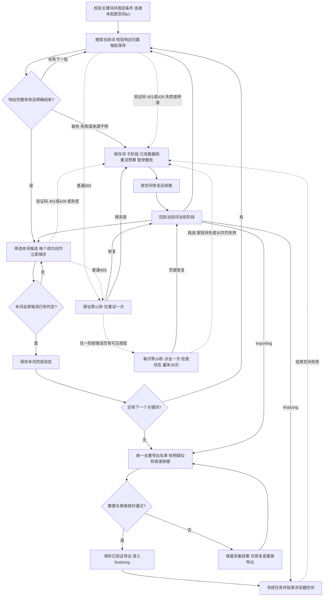

# 多关键词顺序查找设计

日期：2026-10-21，Asia/Shanghai。

关联：[测试用例](2026-10-21-多关键词顺序查找-测试用例.md)、[实现计划](2026-10-21-多关键词顺序查找-实现计划.md)、[脚本流程Review](2026-10-21-脚本操作流程Review.md)、[项目主记录](../../../README.md)。

## 用户目标与现状

用户希望固定找人流程，减少反复开页和助手临场拼接脚本：输入多个关键词，完成第一个词的搜索和数据筛选后再处理第二个，顺序循环到最后；内容有歧义但主要条件满足也可收录，人工核验最终名单。

已有能力：参数化单词视频搜索、作者及来源去重、正常滚动翻页、主页资料与作品采集片段、地区字段读取、模板化收录依据、普通403等待11秒重试一次。查找任一阶段出现可见浏览器错误页按钮时，可在三十次内按页面恢复；普通API 403仍单次重试。缺口是统一配置、可复用主页/窗口统计适配、逐词搜索与筛选调度、按阶段恢复，以及新候选收录规则。现有搜索器达到目标人数会提前返回，不能直接作为“循环到最后”的调度器。

## 模块边界与拆分评估

本次是一个端到端业务模块、一个实现Task。用户可见闭环是“关键词列表→候选名单”；关键词切换依赖搜索结束和候选判断完成，跨词复用依赖同一作者数据与固定统计窗口，断点必须一起维护。按搜索、邮箱、播放、地区等技术步骤拆成独立交付会留下无法验收的中间状态，因此保持同套三份文档。既有搜索/地区模块作为依赖，不重新另建平台功能；导出是本模块的验收出口。

非目标：新增CRM页面、数据库迁移、站外找邮箱、邮箱可投递性检测、AI自动审核、后台定时任务、并发浏览、第三方采集服务或代理切换。LinkedIn不在范围内。历史50人任务与已交付5人表格不重算、不迁移、不自动续跑。

## 输入与固定参数

新统一入口计划从配置读取 `keywords` 数组；单元素数组就是单关键词，含空格的短语保持整体。示例只说明格式，不代表授权执行新任务：

```json
{
  "keywords": ["christian skits", "bible comedy", "church humor"],
  "country": "US",
  "days": 10,
  "minAverageViewsExclusive": 50000,
  "requireBioEmail": true,
  "targetCount": 5
}
```

去除关键词首尾空格；相同词忽略大小写去重，保留首次输入的文字与顺序；空数组、非字符串、空白项、非法天数或门槛在访问网站前报错。未知参数不静默忽略。

keywords、days及minAverageViewsExclusive为必填；days为正安全整数，门槛为非负安全整数。country显式提供有效地区代码或null（null表示不按地区过滤），requireBioEmail默认true且须为布尔值，targetCount可缺省或为正安全整数。搜索结果分页最小间隔10500ms；主页作品分页最小间隔3000ms；其他浏览器动作最小间隔10500ms。不新增并发或自动调速选项。

创建新批次时固定配置、顺序及Asia/Shanghai完整自然日窗口：如2026-10-21启动、days=10，窗口为2026-10-11 00:00至2026-10-21 00:00（结束不含）。跨关键词和恢复均不移动窗口。恢复时配置、关键词顺序不一致即拒绝，另开新批次；不修改原任务含义。

**正常结束条件为全部关键词完成。** 达到targetCount只更新进度提示，不结束搜索、不截断后续词，也不自动裁掉超出目标的结果；全词结束后导出全部符合及疑似符合的唯一作者，不足目标如实报告。用户中止或访问异常仍会暂停，不能为循环到最后而跳过阻断。

2026-10-21用户补充确认：超过目标人数的结果全部导出，人工再挑选；“大部分符合”只放宽内容方向，地区、邮箱、均播等数据条件仍须核实。本次不新增字段缺失也交付的名单规则。

## 顺序流程与完成口径

0. 新真实批次由主助手按Ego流程只创建一次TaskSpace，记录真实spaceId，复用初始p1作为唯一工作页；入口显式传入该页，不依赖旧搜索器的p3默认值。搜索、主页与必要的地区详情顺序复用同页；结束一次账号检查后直接去下一账号，不为归位额外开页。恢复只连接记录的原空间和原页；不可用时暂停，不换空间重试。dry-run不创建空间或页面。
1. 取当前关键词，正常打开TikTok视频搜索；一批一批滚动，保存候选、作品文案、来源、游标及hasMore。响应必须可靠关联当前关键词与当前页面/导航批次；旧关键词的迟到响应不能改记成当前词，无法关联则留缺口。被动读取正常页面响应，不拼装或重放后台请求。
2. 只有本批相关响应均成功读取、通过业务校验且明确hasMore=false，才能认定该词搜索完毕。部分响应读取失败时即使另一条hasMore=false，也必须incomplete、exhausted=false，错误优先于完成标志。有效空结果可以进入空候选完成；无响应、加载失败、hasMore缺失均不能冒充搜索结束。
3. 该词搜索结束后，处理所有来源包含该词的候选。启用必需公开邮箱时，先读正常搜索响应中的 `author.signature` 字段（不是页面渲染后的摘要文字）：简介为空，或非空但无邮箱样式文本且结尾没有明显省略标记，按邮箱条件直接排除并跳过主页；有邮箱样式文本或疑似以省略号截断时才打开主页核验当前Bio。已缓存的同批已核验主页邮箱优先复用。之后再采集窗口作品，复用既有地区部件并生成逐项依据。每个候选都必须得到符合、疑似符合、已排除或数据不足的结论后才推进。
4. 已知同一作者复用同批已核验的主页、邮箱、作品及地区数据；合并新关键词、来源作品和内容证据，并用缓存重新判断相关性，避免跳过新增证据。不要为了重复命中再次开同一主页。
5. 该词搜索与筛选都完成后标记completed，再进入下一个词。最后统一导出、核对并标记任务完成。

全部词共用同一套筛选条件。关键词是发现入口，内容满足任一相关方向即可；不要求账号同时命中所有关键词。来源关键词可多项，输出作者只有一行。

## 核验、内容与收录

身份核验指当前主页的用户名、路由及已知稳定作者ID对应目标，不是实名认证。进入主页核验时，资料未就绪或身份不符进入检查状态，不能将空主页Bio当作没有邮箱。搜索预筛是明确的省时排除策略：搜索简介空或无邮箱且无明显尾部省略标记时，不声称主页Bio已核验，只记录搜索签名与排除依据。可识别的尾部标记包括 `...`、`…`、`⋯`、`﹒﹒﹒`；有邮箱提示或疑似截断均打开主页核实。该启发式识别不了无标记静默截断；已有批次70个对照样本的搜索签名与主页Bio一致，另33个非空签名未对照，因此不构成完整性保证。进入主页核验后，只提取当前公开Bio邮箱并保存原文、主页及采集时间；不保证邮箱归属或能收信。

作品按“最新”排序，正常滚动到窗口开始前的非置顶作品或明确列表结束。置顶旧作品不充当分页结束依据；真实最新置顶作品仍可作地区来源。公开视频按作品ID去重，排除图文、私密和窗口外作品；真实0保留，缺失数字不补0。作者、时间、顺序或覆盖不完整时保存data_incomplete，不计算伪完整均播。均播必须严格大于配置门槛，不设额外粉丝或最少作品数要求。

主页排序按钮尚未渲染时继续等待；排序控件已出现但状态仍为非“最新”时，先等待状态稳定750ms，再执行一次正常点击。确认“最新”已选中时，直接读取同页正常加载产生的作品列表响应，不重复点击；无法确认排序或列表响应时不计算完整均播，也不重放后台请求。完整覆盖且窗口内确实0条有效视频时，保存sampleSize=0、averageViews=null及no_eligible_videos结论，记录不满足均播条件；不把“已知无样本”当抓取缺失反复重试，也不计算0/0。身份、邮箱或已完成的均播足以明确排除时，不再额外访问地区详情。

复核原包发现其函数将门槛写死为50000，且重复视频播放变化会判冲突；通用模块不直接沿用这两个判定。新模块的门槛取任务配置。同一作品作者与发布时间一致而有效播放观测更新时，保留观测时间与来源，统计采用该作品最新一次有效观测、不重复累加；身份/日期冲突仍留缺口。复用跨词缓存时展示原采集时间，不宣称多个作者的数据在同一瞬间采得。country=null不触发为筛地区而额外开详情；地区如无现成字段则注明未核验。

地区默认读取最新公开视频locationCreated；先复用正常作品列表或已加载目标详情，缺字段才额外开详情。保存作品与作者ID、原值、字段路径、时间和链接，不能用浏览器上下文region代替。US是视频地区字段证据，不声称本人现居美国。

不接大模型API。内容规则使用公开Bio、合集、文案与标签，覆盖skit/skits、comedy、humor/humour及christiantiktok、christianhumor、christianskit等组合标签。任一输入方向有明确公开原文可判符合；仅部分相关或语义有歧义时判suspected并进入交付名单，写明支持项与疑点，人工核验结果。宗教讽刺允许；不推断个人信仰。历史主题作品注明日期，不声称近期持续发布该方向。

本轮“大部分符合”按上下文用于内容判断放宽，不新增百分比或3/4评分阈值；没有修改均播、美国地区、公开邮箱等既定数据条件。明确不满足必要数据条件记排除，数据无法确认记缺口；不能伪造满足。交付名单分别统计confirmed和suspected，其余数据不足/排除记录留在任务数据中供追溯。

## 节奏、错误与恢复

2026-10-22用户确认直接修改：统一入口的小步滚动替代直接跳底；每步使用原生鼠标滚轮向下滚可见区域（clientHeight，裁剪到视口）的四分之一，至少相隔1秒。整批操作保留搜索10500ms/主页3000ms间隔。检测到相关分页requestWillBeSent即停滚，匹配当前页面、来源origin、接口及关键词，等待responseReceived与loadingFinished，按请求顺序核验cursor分页链并读取完整正文。冷却期间每250ms接收事件，不丢弃同一分页会话的预加载；真实导航、排序或错误页按钮恢复才重置会话，从初始cursor=0核验。站点自行预加载不受脚本主动操作的间隔约束。

正文逐页通过分页链校验后才可保存为可复用部分证据；同批相同输入cursor、输出cursor和作品顺序的重复页合并到原顺序，保留后一次正文；冲突、跳页、末页后出现另一页或来源不明均暂停。读取正文期间出现新分页请求也须纳入检查，不能凭先到的末页结束。下载等待最多30秒，资料就绪12秒，布局稳定5秒；慢滚寻找加载位置单独最多120秒，原地3秒无位移则暂停检查目标，不能拿高度不变或超时冒充末页。相关网络及页面状态稳定300ms后交付本批，不等待视频图片等全部网络空闲。冻结条件、前N位作者顺序、指标计算、公开邮箱及地区条件保持原规则，断点和30次按钮预算沿用现有存储。新版尚未用真实TikTok验收。

- 一个任务沿用同一Ego空间、同一批次，同一时间仅一个进程顺序操作；不支持多个进程竞争写同一批次。发现runtimeRunning的有效进程则拒绝第二次启动。
- 搜索结果翻页至少间隔10.5秒；主页作品分页至少间隔3秒；打开主页、排序及地区详情等其他浏览器动作至少间隔10.5秒。全程串行并等待数据就绪，一次只触发一批；读字段不靠反复开页。
- 普通HTTP403在原地址等待11000ms后仅重试一次；页面和其本批数据响应共用预算，包括搜索、主页、作品分页及地区详情。地区详情重试时，若当前页仍是目标视频则使用 `reload()`；任一阶段若错误页快照确认`HTTP ERROR 403`或`ERR_BLOCKED_BY_CLIENT`并有可见“重新加载”按钮，每次点击前等待至少10秒，点击一次后重新检查页面，最多30次；恢复、出现验证码/登录提示、按钮消失或控制权异常时立即停止。页面出现“Please wait”时等待5秒并复查。按钮循环自身保证每次重试在上次结果检查结束后等待至少10秒，不依赖调用方的翻页间隔；成功后不再等待或点击。普通HTTP/API 403及其同址重试预算不扩展为三十次；三十次上限只用于可见浏览器错误页按钮。普通重试耗尽后，若原页已确认有支持的按钮，仍可使用尚未消耗的按钮预算；续跑不得被普通403的前置检查挡住。标题拆分为多个文本节点或不含空格时仍应识别同一错误页。地区动作历史保存在`videoRegion.navigationAttempts`，恢复时保留旧记录、只补剩余点击次数。再失败保存当前词、阶段和缺口后暂停整批，不进入下词。
- 验证码、401/429、失去控制权不走403重试；不自动接管用户控制的空间。登录弹窗先判断是否只是可关闭提示，不把任意弹窗或403称为必须登录。
- 页面返回200但目标数据未就绪时等待，不立即判缺字段。非403服务器/解析错误保存inspection，不静默认作空结果。
- hasMore=true但游标、来源作品和页面结果连续没有推进时保存search_progress_stalled并暂停，不无限翻页、不标exhausted。
- 正常字段缺失在该账号留具体data_incomplete结论，继续其他候选；浏览器级访问/控制问题暂停整批。
- 恢复从当前词当前阶段继续，跳过completed词与已完成账号动作。原页面存在时复用；页面丢失可能要通过正常滚动重新经过已见结果，但不重做已核验账号，不拼接游标重放后台请求。
- 每个账号保存identity、email、posts、metrics、region、decision子阶段和nextAction。主页事实与首批作品读取成功后、每次分页成功后、地区尝试前后立即保存可复用快照与对应断点，再发起下一次导航或翻页。不能等整个账号完成或下一页成功才保存首屏。恢复读取这些断点，只补未完成动作；重试预算也随动作保存。403重新打开主页可能返回首屏，保留已采作品并去重，按正常滚动恢复到缺失处，不把已见首屏当新增覆盖。
- 账号结果先落盘，关键词completed及currentKeywordIndex最后更新。写入中断后允许幂等重放，不重复计数。正常返回或抛错均由finally清runtimeRunning/PID；进程被强制终止时无法承诺执行finally，resume先确认旧进程已结束再修复遗留标志。
- 导出失败保留所有词已完成状态；恢复只重做导出和验证。完成表格验证后才能将任务标completed并结束Ego空间；暂停/错误时不finish。

## 数据与接口

新批次使用独立目录与schemaVersion，历史文件保持原状。`config.json`保存冻结配置与窗口；`execution-state.json`保存currentKeywordIndex、stage、逐词状态及游标；候选队列和逐作者结果保存来源关键词及每项检查状态；选定公开响应用JSONL留证。原有单词搜索继续支持旧调用，通用调度调用时显式关闭“达到目标提前退出”，不破坏旧默认行为。

统一workflow独占本批运行标志和阶段写入。现有runSearch会自行检查/修改runtimeRunning与任务status，不能由外层设置运行中后直接嵌套调用同一批次的旧完整入口；需提取可注入的单批发现适配，让统一workflow管理生命周期，旧CLI仍由原包装层管理。不会临时清运行标志来绕过保护，也不引入多进程并发。

逐词阶段：pending → searching → filtering → completed；暂停保存resumeStage，不改成completed。任务阶段包括running、paused、exporting、export_failed、finalizing、completed。finalizing表示导出已验证，仅剩结束空间；失败后恢复不重复导出。每词独立searchCheckpoint；兼容旧全局searchCheckpoint时必须核对keyword，不能把上一个词的游标作为下一个词已执行的证据。

内部接口：`runCampaign({config,runDir,browser,exporter,onProgress,resume,spaceId})`负责顺序调度；`discoverBatch({keyword,checkpoint})`返回候选/证据/hasMore/新断点；`qualifyCandidate({candidate,config,cachedCapture,checkpoint,onCheckpoint})`逐动作调用持久化回调，最终返回逐项事实、判定、缺口和可复用快照；`exportResults({runDir,results,config})`使用现有表格方式生成XLSX并核对。checkpoint含子阶段、下一步、已采作品边界与当前动作重试状态。接口按单进程、注入适配器设计，离线测试不打开浏览器。

## 输出与可观察状态

运行状态显示当前词/总词数、searching或filtering、已处理候选数、confirmed/suspected数、停止原因。没有新增Web页面。最终XLSX复用名单、主页证据、视频证据结构，名单增加来源关键词和复核状态，保留“收录依据”。疑点写入依据；长ID文本保存，窗口内视频数与均播公式必须和逐作品记录一致。空名单仍输出表头与任务完成/不足说明，不能伪造目标人数。

## Brainstorming需求评审

状态：设计评审已完成。流程图状态：已确认（用户于2026-10-21确认）。新双关键词批次在线验收进行中，因最新视频详情页真实403暂停；见[验证与实现Review](2026-10-21-开发验证与实现Review.md)。

复核补充：原包50000固定门槛与重复作品观测变化的限制，以及本次[脚本流程Review](2026-10-21-脚本操作流程Review.md)发现的响应归属/完成误判、混合HTTP状态、作品分页重试、账号内断点和Ego初始页/状态所有权缺口，已同步设计、测试用例和计划。后续已完成新入口实现并修复旧搜索器三项问题，详见实现Review；原包归档与历史片段不修改。

已主动补齐：搜索结束与筛选完成双门槛；达到人数不提前退出；跨词游标及响应归属隔离；重复作者新增证据重新判定但不重复开页；空结果与失败区别；无进展防循环；403共享预算与401/429优先停止；200加载等待；逐页落盘和幂等恢复；导出失败不重新采集；confirmed/suspected分开；单工作页及单一状态所有者。用户已确认超目标全部导出、仅放宽内容方向；目前没有未解决的关键业务口径。流程图已于2026-10-21获用户确认，已完成Red、Green及回归，详见实现Review记录。

### 线上对标与本项目取舍

访问日期2026-10-21。来源事实与项目推断分开；只借鉴输入与批处理组织，不接入这些产品。

来源事实：[Apify/Clockworks官方输入说明](https://apify.com/clockworks/tiktok-scraper/input-schema)接受searchQueries数组，可选Top/Video/Profile范围；其默认搜索范围为Top，Profile数量按query配置。[n8n Loop Over Items官方说明](https://docs.n8n.io/integrations/builtin/core-nodes/n8n-nodes-base.splitinbatches/)描述逐批处理与完成后done输出，强调分页循环的终止条件；[Wait官方说明](https://docs.n8n.io/integrations/builtin/core-nodes/n8n-nodes-base.wait/)说明按间隔暂停及保存/恢复执行数据。上述文档没有证明Apify按输入顺序逐词完成筛选，不能借此声称第三方支持本项目的具体流程。

| 对标维度 | 来源事实或核验限制 | 本项目推断及接受项 |
|---|---|---|
| 入口与默认范围 | Apify为关键词数组及可选范围；n8n按输入items分批 | 使用有序keywords，默认视频；明确同词搜完且筛完才切词 |
| 筛选组织与生效时机 | Apify输入字段可配置；n8n分页示例用条件分支控制循环 | 启动前校验并固定整批条件，不在每词之间移动日期或门槛 |
| 已生效条件展示 | 本次未核验两者真实账号界面的条件展示 | CLI/状态文件显示固定条件、当前词与阶段，不照搬UI |
| 结果布局 | Apify提供数据导出；n8n done返回处理后的数据 | 统一按作者出一行，多关键词来源合并，疑似与确认分开计数 |
| 加载/空态/错误态 | n8n明确循环终止和暂停；两者具体空态UI未核验 | empty仅据有效响应，缺响应/停滞/访问受限分别记录并恢复 |
| 权限边界 | 本次未登录第三方产品核验其账号权限 | 仅当前Agent控制的原Ego空间；不能换空间或身份恢复阻断 |

接受项已落实到本设计、测试用例与计划：数组输入、逐项完成再推进、明确终止、当前阶段展示、证据追溯、暂停恢复。明确排除：第三方服务接入、并发加速、默认Top搜索、按目标人数提前退出、把缺失数据当空结果、自动换账号或空间。

## 验收标准

两个以上关键词严格按search(k1)全部结束→filter(k1)全部判定→search(k2)的顺序运行，达到目标仍执行后词；相同作者只交付一行并保存全部来源；暂停不切词、恢复不重做已完成核验；间隔和403预算准确；无需大模型API；内容疑似按新规则交付且标疑点。现有搜索/地区测试、真实快照回放和导出核对均通过；未做真实新批次时明确报告在线端到端未验收。

## Review后的流程图



流程图状态：已确认（用户于2026-10-21确认）。图中K只按保存阶段返回searching、filtering、exporting或finalizing之一，不并发。


## 2026-10-21用户调整：累计10词或100位停止

本轮明确覆盖默认“全部词跑完”策略，历史任务不改。输入保留用户15词顺序，已完成的christian skits与bible comedy计入累计10词；继续church humor起的8词。唯一已确认或疑似名单累计达到100位时，筛完当前账号并保存立即停止，不再打开下一个账号；否则累计完成10词后不启动第11词。重复作者只计一位；数据不足与排除不计入人数。原10位及已核验资料缓存复用，统计窗口/地区/邮箱/均播条件不变。

新增可选maxKeywords正整数及stopAtTarget布尔值（启用须提供targetCount）；不传两字段时保留旧全词策略。额度与固定配置一起保存，恢复不重置。正常额度结束使用completionReason=keyword_limit_reached或target_reached，保留未完成词/候选，不把额度停止称为全词完成。导出/空间结束失败后只恢复对应阶段，不重新搜索或多开账号。保存 verified 导出后正常结束本轮；下一轮须用户授权。

当前15个用户词尚有剩余时只列待处理词，不另生AI词。全部用户词完成后才由助手根据已有词生成去重的新建议，并询问是否搜索，未经确认不访问新词。关键词生成不在采集脚本中接大模型API。

Brainstorming需求评审：已完成（既有模块的明确停止规则修正）。已核对重复作者、已有2词/10人、账号内100人触发、导出恢复和未搜索词状态；不引入新的界面、并发或数据迁移，跳过线上产品对标。用户本轮明确给出规则并要求继续，沿用已有模块和流程。

在线验收补记：新额度批次累计10词后正确停止，682位候选均已处理、14位导出，剩余5词保留；local-export委托与公式/文本ID核对通过。详情见开发验证与实现Review的“10词额度在线验收”。


2026-10-22后续真实验收：[book慢速滚动实测](2026-10-22-book-慢速滚动实测.md)已完成，10批/114位全部处理/5收录；搜索42步、主页20步，最短滚动间隔1063ms；6个详情403按间隔点击后均恢复。窗口、均播、地区与XLSX已复核，原生Excel未验证。
