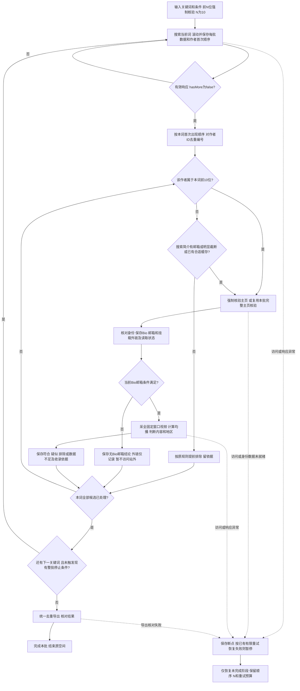

# 前N位强制主页核验设计

当前参数更新：用户于2026-10-22追加确认N=20，替代原10；新批次前20位强制查主页，第21位起沿用原预筛，搜索仍翻到底。下文10/11为原开发与验收样例，参数化算法不变；历史冻结配置和测试证据保持原值。

日期：2026-10-22，Asia/Shanghai。所属模块：TikTok达人查找。

关联：[测试用例](2026-10-22-前N位强制主页核验-测试用例.md)、[实现计划](2026-10-22-前N位强制主页核验-实现计划.md)、[需求Review](2026-10-22-前N位强制主页核验-需求Review.md)。既有基线为2026-10-21多关键词顺序查找三份文档；本变更仅覆盖前N位是否打开主页及主页外链保存，其他规则沿用基线。已按2026-10-22用户确认完成实现；开发和Review证据见同目录开发验证与实现Review。

## 已确认需求

- 用户将N指定为10；每个关键词按作者ID去重后的前10位全部核验主页，不因搜索signature为空或无邮箱跳过。
- 用户已明确选择：搜索仍翻到有效末页；前10位强制核验，第11位起沿用原筛选规则。N不是搜索深度、候选数上限或合格人数目标。一个词实际打开的主页总数可能超过10。
- 前10按这个词搜索结果中作者首次出现的顺序，不按粉丝/播放排序，不按全局候选库插入顺序。重复视频不额外占名额。
- 跨词重复作者复用本批已完成的主页核验，不把“前10”解释成每词补足10个全新账号。少于10位时核验实际人数。
- 原22位名单继续人工核验，新一组词仍暂缓；本变更不授权自动启动新搜索或改历史批次。

## 范围与现状

| 项目 | 现在代码 | 本次要求 |
|---|---|---|
| 搜索 | 当前词搜到有效hasMore=false后筛全部候选 | 保持 |
| 排序 | queue是跨词全局插入顺序 | 另存每词首次作者顺序，用于前N归属 |
| 预筛 | 空signature或无邮箱/无尾部截断可直接排除 | 前N绕过这一步，其余保持 |
| 主页 | 核对身份、Bio邮箱，符合后采作品及地区 | 每次实际核验主页时补存挂载外链及读取状态 |
| 配置 | 尚无前N强制参数 | 新增可选forceProfileFirstN，新批默认建议10；历史缺省不改变行为 |
| 缓存 | processedKeywords及已采capture可跳过重复动作 | 不能用旧的“搜索预筛排除”冒充主页已核验；前N须有本批主页与外链核验标记 |

这是一个现有业务模块内的完整Task。配置、逐词顺序、强制检查和证据保存共同构成可验收闭环，不拆成只改数字或只读字段的孤立交付。预计涉及config、workflow、profile、browser及结果展示/验证；不重构其他平台或浏览器引擎。

## 参数与兼容

计划参数forceProfileFirstN为非负安全整数，0或缺省保持旧预筛行为；本次已确认采用10。加入统一参数校验、dry-run、示例说明及冻结配置，恢复时拒绝改变N。旧配置与旧批次不自动补10，不移动统计窗口，不重跑历史结果。项目决策JSON只是设计记录，不是当前CLI已支持的运行配置。

## 搜索与顺序

1. 正常搜索当前关键词并分批保存，搜索翻页最小10.5秒。以已校验hasMore=false认定当前搜索完毕；搜索不足或异常不能用“已达到10人”结束。
2. 保存本词authorOrder或等价的持久化首次发现顺序；跨批重复、跨词重复及作者别名按稳定ID处理，同批次内按原响应条目顺序编号。
3. 全局queue已有历史账号时，也必须按本次当前词的响应顺序确定前N；不能切queue.filter(...).slice(0,N)就冒充当前词前N。
4. 第1到第min(N,作者数)位强制基本主页核验；第N+1位起继续原signature预筛和缓存规则。每位保留来源词、该词发现序号、强制/普通核验原因及结果。
5. 处理完当前词所有候选再切下一词。既有显式maxKeywords/stopAtTarget等整批停止条件仍有效，触发时保留未完成部分，如实写停止原因，不能称所有候选检查完成。

## 主页及挂链

强制核验的最小动作是：目标主页有效加载→作者ID/用户名一致→读取当前公开Bio→提取Bio明确邮箱→读取独立挂载外链并保存状态。纯读取字段不用AI。

TikTok已经实测的字段为userInfo.user.bioLink.link；页面原生bio_url链接的target可作备用与交叉检查。不能只检查signature里的URL，也不能用搜索author缺bioLink来判无外链。每次实际读取主页可一并记录外链，N控制强制访问而非限制哪些已打开主页能保存字段。

外链状态至少区分present、none、unknown。只有有效且身份匹配的主页，字段与原生页面入口足以确认未挂载时，才能记录none；资料未就绪、字段提取失败或证据冲突应是unknown。保存链接原文/完整目标、原始href或字段路径、主页/作者和时间；仅将合法http/https视为可用网站URL，不擅自删除查询参数，不访问落地页。

同批已核验且外链状态明确的主页可复用；缺外链检查标记、此前只是no_search_bio_email、旧批次未核验的新字段不能满足强制检查，必须补当前主页基本读取。新批次与恢复要有稳定的本批检查归属，不能把上一批的processedKeywords当成本批基本主页已完成。窗口统计缓存仅在条件和固定窗口一致时复用，否则重新取齐并计算。

主页访问失败不会用第11位替换前10位来凑成功人数。浏览器级异常保存断点暂停；正常确认账号私密/不存在等按已有规则留结论，不假装主页字段已核验。

## 邮箱、深查和输出

邮箱资格仍只接受当前公开Bio中的明确邮箱。前N只是多做主页基本读取，没有放宽邮箱、均播、地区条件。

- Bio有合规邮箱：继续已有完整窗口统计、内容与最新视频地区核验。
- Bio无邮箱但有外链：保留外链及“未取得Bio邮箱”原因，当前仍不进入合格名单；不自动打开站外找邮箱。
- Bio无邮箱也无外链：记录已查主页后的排除原因。
- 数据缺失与明确不满足分开。仅内容歧义可标疑似；硬性条件不放宽。

所有核验/排除记录保留在候选和作者证据中；最终主名单继续只导出confirmed/suspected，一人一行且有收录依据。外链写入主页证据和结果，展示来源与状态；保持原有均播公式、文本ID及来源证据可追溯。具体表格列以不破坏既有数据含义为准，新增列仅追加，不把站外邮箱混入Bio邮箱。

## 异常和断点

复用已有同空间串行策略。普通403原址11秒一次；支持的可见错误页按钮每次至少等10秒、最多30次，预算持久化；主页作品翻页最小3秒。验证码、401/429、控制权丢失等按既有暂停。搜索/页面正文读取失败仍按已有安全暂停，不借本次变更扩成无限重试。

每词首次作者顺序、N、强制名单、完成的主页/Bio/外链子阶段及缓存归属均须恢复一致。账号数据先保存、总进度后推进；只完成了邮箱预筛的旧记录不能被恢复逻辑误跳过。导出恢复不重搜、不重查主页。

## 线上对标与本项目取舍

访问日期2026-10-22，使用官方文档，不假定第三方具备本项目的具体规则。

- [Apify输入Schema](https://docs.apify.com/actors/development/actor-definition/input-schema)：事实是参数由Schema定义和校验，示例区分抓取深度与页数上限。本项目推断：强制主页人数与搜索完成条件必须分开命名和展示，N不能当停止搜索额度。未对标其具体控制台登录后页面。
- [n8n Loop Over Items](https://docs.n8n.io/integrations/builtin/core-nodes/n8n-nodes-base.splitinbatches)：事实是原始输入可保留、按批输出，处理完成有done输出；分页循环需明确终止条件。本项目推断：hasMore控制搜索闭环，每词作者顺序与强制检查作为后续处理条件，不能拿batch size或N替代done。

入口/默认范围采用新批可选N、缺省兼容；筛选组织在搜索完整结束后按序核验；生效条件在配置/状态记录N与原因；结果仍统一名单加主页证据；空态/错误态区分不足N、加载失败和有效结束；权限边界继续当前Ego空间原有控制权。接受参数校验和两种边界分离；不引入Apify/n8n服务、并发、代理、新UI页面或第三方恢复手段。以上取舍同步到用例和计划。

## 需求Review与验收

Brainstorming需求评审：已完成。已逐项检查首次排序、少于10、重复作者、跨词缓存、搜索溢出、旧预筛记录、外链未知/为空、只读外链与邮箱资格、异常预算、固定窗口、部分完成及导出一致性。评审结论见同目录需求Review；没有把站外邮箱扩展作为已确认需求。

验收核心：搜索仍有效翻完；每词前10位有本批基本主页与外链检查或可追溯的同批缓存；第11位起保持原预筛；旧批不变；恢复不漏查也不重复；资格和证据不失真。实现完成，模块90/90、相关回归65/65通过；线上新版本验收尚未执行。

流程图状态：已确认（2026-10-22，用户“确认然后开发”）。

## 2026-10-22真实验收后的实现修正

用户授权bible/christian两词、N=20、原数据条件，在空间55实测完成。185/124位按词作者、308位唯一作者全部处理，4位收录；两词有效末页且前20实际检查。详细过程与验证见[真实验收](2026-10-22-bible-christian-真实验收.md)。本段为原设计内的实现闭环修正，不放宽硬条件：原生点开头用户名应按稳定ID入队并保留顺位；目标主页明确statusCode=209002时记单账号数据不足，普通登录提示仍暂停；主页续页正文丢失在原空间归档旧证据后最多自动重放一次，成功清除失败标记，超次数暂停；重核未知挂链不得清掉视频403或正文补采预算；主表收录依据用逐项摘要，完整原文仍保留在证据页和JSON。166项测试、真实审计和Brainstorming bounded代码Review通过；独立Reviewer未做。30次点击全部失败和有邮箱主页跨词复用本轮无真实触发样本，仍以离线测试为证。
